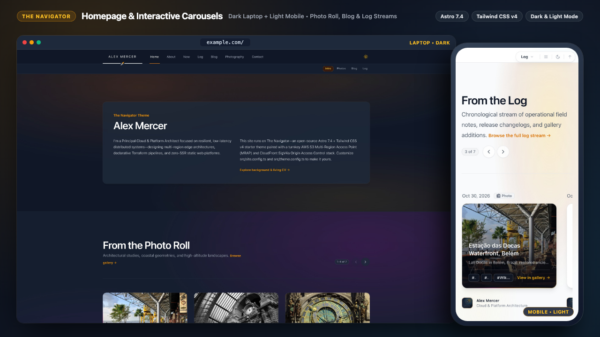
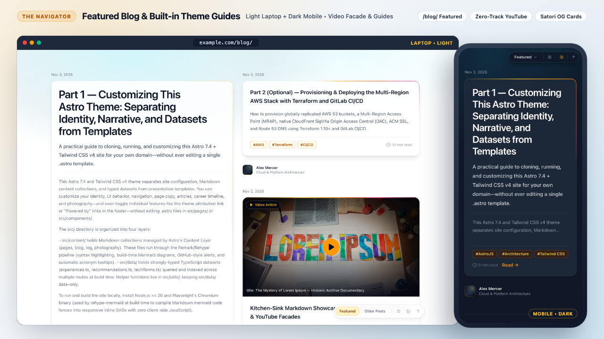
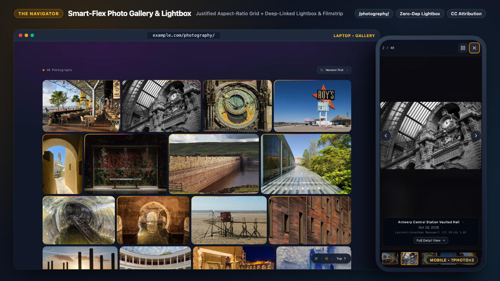
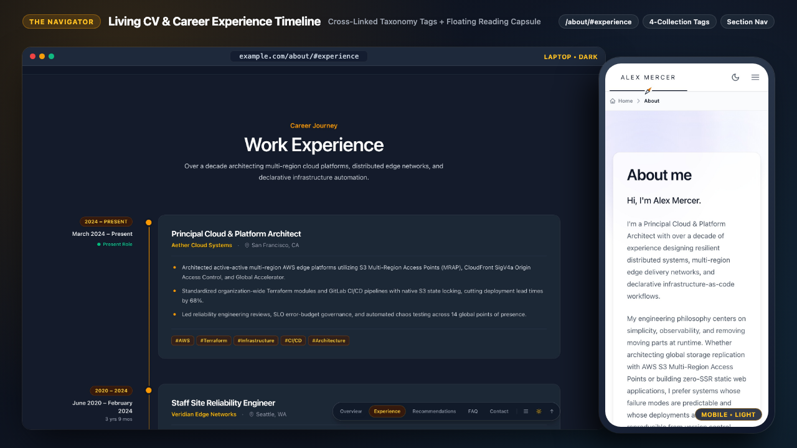
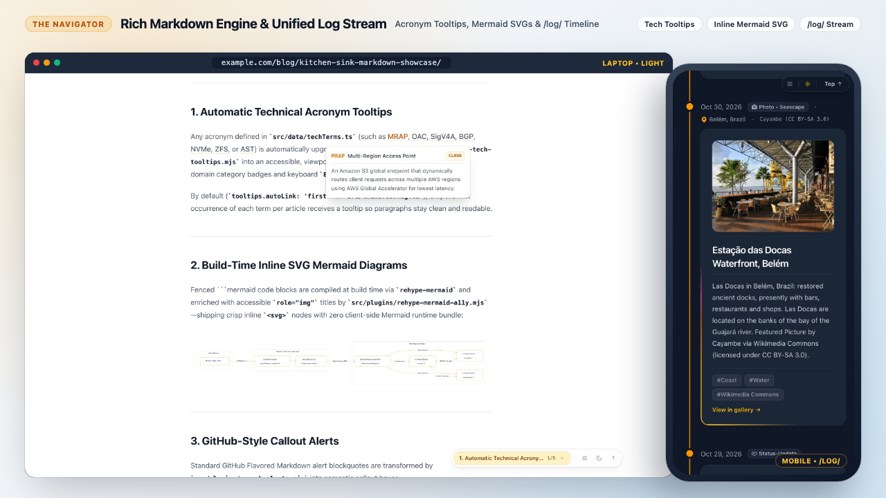

# The Navigator — Astro 7.4 & Tailwind CSS v4 Static Theme + AWS MRAP Infrastructure

[](https://the-navigator-sage.vercel.app/)
[](https://github.com/edstuurman/the-navigator/actions/workflows/deploy.yml)
[](https://astro.build/)
[](https://tailwindcss.com/)
[](./terraform/README.md)

> ### 🚀 **[Explore the Live Demo → https://the-navigator-sage.vercel.app/](https://the-navigator-sage.vercel.app/)**
>
> Experience **The Navigator** live in your browser — test the instant Light/Dark theme switcher, interactive 7-card carousels, aspect-aware Smart Flex photography gallery & lightbox (`?photo=1`), build-time SVG Mermaid diagrams, technical acronym tooltips, and the responsive floating section navigation capsule.

**The Navigator** (`the-navigator`) is an open-source starter template for a fast, zero-SSR static personal engineering site, living CV, operational log, technical blog, and photography gallery built with **Astro 7.4** and **Tailwind CSS v4**, paired with turnkey **Terraform** infrastructure for globally replicated **AWS S3 Multi-Region Access Points (MRAP)** + **CloudFront** delivery.

[](https://the-navigator-sage.vercel.app/)

---

## Visual Tour & Screenshots

| Technical Blog & Featured Article Rail | Smart Flex Photo Gallery & Lightbox |
| :---: | :---: |
| [](https://the-navigator-sage.vercel.app/blog/) | [](https://the-navigator-sage.vercel.app/photography/) |
| Bidirectionally balanced featured card rail, reading-time metrics, click-to-load YouTube facades, and tag-linked article cards on [`/blog/`](https://the-navigator-sage.vercel.app/blog/). | Zero-dependency lookahead Smart Flex row engine and accessible `<dialog>` lightbox with zoom, filmstrip, and deep-linking on [`/photography/`](https://the-navigator-sage.vercel.app/photography/). |

| Living CV & Tag-Linked Experience Timeline | Rich Markdown, Inline Mermaid & Operational Log |
| :---: | :---: |
| [](https://the-navigator-sage.vercel.app/about/) | [](https://the-navigator-sage.vercel.app/log/) |
| Interactive career spine on [`/about/`](https://the-navigator-sage.vercel.app/about/) cross-linking roles to technical articles, logs, and photography via shared taxonomy badges. | Build-time adaptive light/dark SVG Mermaid diagrams, glassmorphic `<abbr>` tooltips, GitHub alerts, and unified [`/log/`](https://the-navigator-sage.vercel.app/log/) stream. |

---

## Architecture & Highlights

- **100% Static Output (`output: 'static'`)**: Zero server-side runtime, lightweight progressive-enhancement client scripts (~4–6.7 KB gzipped per route), and deterministic HTML routes ready for S3 + CloudFront or Vercel.
- **Unified 4-Collection Taxonomy**: Shared tags connect Career Experience (`src/data/experiences.ts`), Technical Articles (`src/content/blog/`), Operational Status-Updates (`src/content/log/`), and Photography (`src/content/photography/`) into cross-linked topic archive pages (`/tags/[tag]/`).
- **Single-Source Changelog Stream**: Root `CHANGELOG.md` is parsed at build time and merged directly into `/log/` alongside status-updates and photo rolls with static pagination and category routes (`/log/status/`, `/log/changelogs/`, `/log/photos/`).
- **Zero-Dependency Aspect-Aware Smart Flex Photo Gallery & Lightbox**: Lookahead Smart Flex row engine and accessible `<dialog>`-style `#photo-lightbox` (`src/components/pages/PhotographyView.astro`) with WebP optimization, zoom/fullscreen controls, thumbnail filmstrip, keyboard/swipe navigation, sort-order switching, `?photo=ID` deep links, and individual story pages (`/photography/[id]/`).
- **Configurable Section Navigation & Floating Reading Capsule**: Optional frontmatter-driven section pills (`src/components/SectionNav.astro` & `src/utils/sectionNav.ts`) that morph on scroll into a floating glassmorphic capsule (top-docked on desktop; bottom-docked on mobile with footer collision avoidance) complete with active heading spy, synchronized light/dark theme toggle, site navigation hamburger menu, and back-to-top control.
- **Interactive 7-Card Homepage Carousels**: GPU-accelerated CSS scroll-snap carousels (`src/scripts/carousel.ts`) across **From the Photo Roll**, **From the Blog**, and **From the Log** with dynamic slide counters, pagination pills, and keyboard/swipe support.
- **Build-Time Compilers & Persistent Disk Caching**:
  - **Satori + Resvg OG Cards** (`src/pages/og/[...slug].png.ts` & `src/utils/generateOgImage.ts`) with SHA-256 content-addressed caching in `.cache/og-images/`.
  - **Astro Image Cache** relocated to `.cache/astro/` so `npm ci` in CI/CD preserves optimized WebP/AVIF assets across builds (~1.8s warm production builds).
  - **Inline SVG Mermaid Diagrams** (`rehype-mermaid` + `src/plugins/rehype-mermaid-a11y.mjs`) rendered at build time via headless Chromium with zero client Mermaid bundle.
  - **Click-to-Load YouTube Embeds** (`src/plugins/remark-youtube.mjs` + `src/scripts/youtube-embed.ts`): a fenced ```` ```youtube ```` block compiles to a thumbnail + play-button facade cached in `.cache/youtube-thumbs/`, loading the privacy-enhanced iframe only on click.
  - **Technical Acronym Tooltips** (`src/plugins/rehype-tech-tooltips.mjs` + `src/data/techTerms.ts`) compiled from `<abbr>` / `<Tooltip>` tags at build time with viewport-clamped glassmorphic popovers.
- **Syndication & AI/LLM Endpoints**: Build-time `/rss.xml`, `/atom.xml`, image-enriched `/sitemap-index.xml` (`/sitemap.xml`), `/llms.txt`, `/llms-full.txt`, and `/llms.json`.
- **Turnkey Multi-Region AWS Terraform Stack & Incremental S3 Deployer**:
  - [`terraform/`](./terraform/README.md) provisions up to 17 regional S3 buckets, cross-region S3 Replication Time Control (RTC), an S3 Multi-Region Access Point (MRAP), CloudFront with native SigV4a Origin Access Control (OAC), a `viewer-request` CloudFront Function (naked-to-`www` 301 redirect + `/index.html` directory resolution), automated `us-east-1` ACM SSL certificates, Route 53 `A`/`AAAA` records, and a dedicated S3 remote state + native `.tflock` bucket (`terraform/bootstrap/`).
  - `scripts/s3-deploy.sh` compares local MD5 digests against remote S3 ETags to upload only modified objects and issue targeted CloudFront invalidations.

---

## Project Structure

```text
/
├── .cache/                     # Persistent build caches (Astro WebP/AVIF, SHA-256 OG PNGs, YouTube thumbs)
├── .github/
│   └── workflows/
│       └── deploy.yml          # GitHub Actions CI/CD (Terraform + Astro build + S3 deploy with dry-run fallback)
├── docs/
│   └── screenshots/            # Theme overview & feature showcase screenshots (1280×720)
├── public/                     # Static assets (favicon.svg, logo.svg)
├── scripts/
│   └── s3-deploy.sh            # MD5/ETag incremental S3 uploader & targeted CloudFront invalidator
├── src/
│   ├── components/             # Clean-room UI primitives (Navigation, SectionNav, Footer, AmbientGlow, Tooltip...)
│   │   └── pages/              # Paginated view templates (BlogIndexView, LogIndexView, PhotographyView)
│   ├── content/
│   │   ├── blog/               # Technical articles (.md)
│   │   ├── log/                # Operational status-updates (.md)
│   │   ├── pages/              # Top-level page titles, descriptions & personal narrative (home, about, now, contact, etc.)
│   │   └── photography/        # Individual photograph backstories & EXIF dates (.md)
│   ├── data/                   # Typed datasets (experiences.ts, recommendations.ts, techTerms.ts)
│   ├── images/
│   │   ├── blog/               # Article imagery processed by astro:assets
│   │   ├── photography/        # Source gallery photographs (1.jpg – 40.jpg)
│   │   └── author.jpg          # Profile portrait & author avatar
│   ├── layouts/                # BaseLayout.astro & BlogPost.astro shells
│   ├── pages/                  # Static route entrypoints (/blog, /log, /photography, /tags, /og, RSS/Atom & LLM endpoints)
│   ├── plugins/                # Custom Remark/Rehype build plugins (alerts, YouTube embeds, Mermaid a11y, tech tooltips)
│   ├── scripts/                # Client progressive enhancement (border-beam.ts, carousel.ts, tech-tooltips.ts, youtube-embed.ts)
│   ├── styles/                 # Tailwind CSS v4 global stylesheet (global.css)
│   ├── utils/                  # Pagination, feed builders, OG renderer, section nav, changelog parser & caches
│   ├── content.config.ts       # Astro Content Layer Zod schemas (blog, log, photography, pages)
│   ├── site.config.ts          # Site identity, author profile, headshots & social links
│   └── theme.config.ts         # Theme UI mechanics (SVG logo, nav, pagination, tooltips, integrations, footer)
├── terraform/                  # Multi-region AWS S3 MRAP + CloudFront SigV4a OAC + Route 53 + ACM IaC
│   ├── bootstrap/              # Step 1: Dedicated S3 bucket for Terraform state (.tfstate) & lockfile (.tflock)
│   └── *.tf                    # Step 2: Regional S3 buckets, replication, MRAP, CloudFront, ACM, and Route 53
├── .gitlab-ci.yml              # GitLab CI/CD pipeline (Terraform infrastructure stages + Astro build & S3 deploy)
├── astro.config.mjs            # Astro 7 + Tailwind v4 Vite plugin + unified Markdown pipeline
├── CHANGELOG.md                # Single source of truth for site releases
└── package.json
```

---

## Prerequisites & Building the Theme

### Requirements
- **Node.js** `>= 20` (tested on Node 22 / 25) and `npm`
- **Playwright Chromium** *(required at build time by `rehype-mermaid` to compile Markdown `mermaid` fences into inline SVGs)*
- **A GitLab or GitHub account (free)** *(for repository hosting and automated CI/CD infrastructure & site deployment pipelines)*
- **A [Formspree](https://formspree.io/) account (free)** *(for the `/contact/` form submission endpoint configured via `integrations.formspree.endpoint` in `src/theme.config.ts`)*
- *(Optional)* **An [Umami](https://umami.is/) account (free tier) or self-hosted instance** *(for privacy-friendly web analytics configured via `integrations.umami.websiteId` in `src/theme.config.ts`)*

### 1. Install Dependencies & Browser Binary

```bash
npm ci
npx playwright install chromium
```

*(For fresh local setups or updating dependencies, `npm install` works as well.)*

### 2. Local Development

```bash
npm run dev
```

Starts the Astro dev server at `http://localhost:4321` with hot module replacement.

### 3. Production Build

```bash
npm run build
```

- `npm run build` outputs the complete static site into `./dist/`. Cold builds generate all responsive WebP/AVIF photography variants and 1200×630 Open Graph PNGs in ~45–60s; subsequent warm builds reuse `.cache/astro/` and `.cache/og-images/` and finish in **~1.5–2.0s**.
- Preview the compiled `./dist/` folder locally at any time with:
  ```bash
  npm run preview
  ```

### All NPM Commands

| Command | Action |
| :--- | :--- |
| `npm ci` / `npm install` | Install project dependencies |
| `npx playwright install chromium` | Install headless Chromium used by build-time Mermaid SVG rendering |
| `npm run dev` | Start local development server at `localhost:4321` |
| `npm run build` | Build production static site and Open Graph cards to `./dist/` |
| `npm run preview` | Serve `./dist/` locally for pre-deployment inspection |
| `npm run astro -- check` | Run Astro CLI diagnostics |

---

## (Optional) Provisioning Infrastructure & Deploying to AWS S3 + CloudFront

Because `npm run build` outputs a pure static `./dist/` directory, you can deploy **The Navigator** to any static host (Vercel, Netlify, Cloudflare Pages, GitHub/GitLab Pages) with zero AWS dependencies. If you want the multi-region AWS S3 Multi-Region Access Point + CloudFront SigV4a stack, full infrastructure-as-code and CI/CD setup instructions are documented in [`terraform/README.md`](./terraform/README.md).

Both **GitLab CI/CD** ([`.gitlab-ci.yml`](./.gitlab-ci.yml)) and **GitHub Actions** ([`.github/workflows/deploy.yml`](./.github/workflows/deploy.yml)) ship out of the box across three stages (`infrastructure` → `build` → `deploytos3`), with an automatic **Starter Template Dry-Run Mode** when `S3_BUCKET` and `TF_VAR_environment_domain` are not yet configured in repository variables:

1. **Infrastructure Track (`terraform:bootstrap` → `terraform:plan` → `terraform:apply`)**:
   - Provisions the dedicated S3 state bucket, regional S3 buckets, cross-region replication, S3 Multi-Region Access Point, ACM SSL certificate, CloudFront distribution (with native SigV4a OAC), and Route 53 DNS records.
2. **Site Build & Deploy Track (`build` → `deploytos3`)**:
   - **Build Stage**: Uses `mcr.microsoft.com/playwright` with `.npm/` and `.cache/` persisted across runs, executing `npm run build`.
   - **Deploy Stage**: Runs `./scripts/s3-deploy.sh ./dist`, which diffs local MD5 hashes against remote S3 object ETags and invalidates only changed CloudFront paths:

```bash
S3_BUCKET="your-primary-s3-bucket" \
CLOUDFRONT_DISTRIBUTION_ID="YOUR_CF_DIST_ID" \
bash ./scripts/s3-deploy.sh ./dist
```

---

## Adapting as a Starter Theme (3-Part Setup Guide)

The theme includes a built-in **3-Part Setup & Deployment Guide** in `src/content/blog/` (featured prominently on the starter homepage and live at [`the-navigator-sage.vercel.app`](https://the-navigator-sage.vercel.app/)):
- **[Part 1 — Customizing This Astro Theme](https://the-navigator-sage.vercel.app/blog/2026-11-03-part-1-customizing-this-astro-theme/)**: Local setup, `src/site.config.ts`, `src/theme.config.ts`, `src/content/pages/*.md`, and `src/data/*.ts`.
- **[Part 2 (Optional) — Provisioning the Multi-Region AWS Stack with Terraform](https://the-navigator-sage.vercel.app/blog/2026-11-03-part-2-provisioning-aws-mrap-cloudfront-terraform-gitlab-ci/)**: Multi-region S3 buckets, MRAP, CloudFront SigV4a OAC, ACM TLS, and Route 53 via GitLab CI, GitHub Actions, or Local CLI.
- **[Part 3 — Automated CI/CD Pipelines, Starter Dry-Run Mode & Deploying to Any Static Host](https://the-navigator-sage.vercel.app/blog/2026-11-03-part-3-ci-cd-pipelines-dry-run-mode-and-static-hosting/)**: Zero-config static hosting (Vercel, Netlify, Cloudflare Pages), 5-second Starter Template Dry-Run CI/CD checks, and 4-tier S3/CloudFront ETag delta sync.

Quick checklist if you fork or adapt this repository for your own site:
1. **Site & Author Identity (`src/site.config.ts`)**: Edit [`src/site.config.ts`](./src/site.config.ts) to customize your site URL, domain, title, description, author profile, portrait (`avatar` / `aboutImage`), and social links.
2. **Theme & UI Mechanics (`src/theme.config.ts`)**: Edit [`src/theme.config.ts`](./src/theme.config.ts) to customize the SVG logo wordmark, Formspree endpoint, Umami analytics toggle, navigation items, pagination sizes, automatic technical acronym tooltips, Open Graph branding, and footer columns.
3. **Personal Content & Media**: Replace `src/images/author.jpg`, `src/images/photography/*`, `src/content/{pages,blog,log,photography}/*`, `src/data/experiences.ts`, and `src/data/recommendations.ts` with your own page narrative, writing, career history, and photographs. *(To hide the 3-step "Customize & Deploy This Theme" onboarding banner on the homepage once your site is ready, set `setupGuide.enabled: false` in [`src/content/pages/home.md`](./src/content/pages/home.md).)*
4. *(Optional)* **Cloud Infrastructure**: Set your naked root domain (without `https://` or `www.`, matching your public Route 53 Hosted Zone — e.g. `example.com`):
   - **CI/CD (GitLab or GitHub Actions)**: Set repository variable `TF_VAR_environment_domain` to `example.com` (see [`terraform/README.md`](./terraform/README.md) for the full variable table).
   - **Local Terraform CLI**: Copy `cp terraform/terraform.tfvars.example terraform/terraform.tfvars` and set `environment_domain = "example.com"` (Terraform automatically provisions ACM SSL and Route 53 `A`/`AAAA` records for both `example.com` and `www.example.com`).
