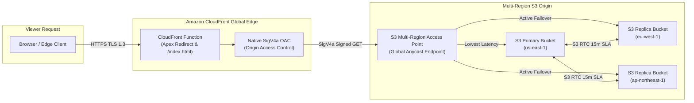

This post serves as a live visual reference and kitchen-sink test suite for the custom Markdown pipeline configured in `astro.config.mjs`. Every component below compiles at build time with near-zero client-side JavaScript overhead.

---

## 1. Automatic Technical Acronym Tooltips

Any acronym defined in `src/data/techTerms.ts` (such as <abbr>MRAP</abbr>, <abbr>OAC</abbr>, <abbr>SigV4A</abbr>, <abbr>BGP</abbr>, <abbr>NVMe</abbr>, <abbr>ZFS</abbr>, or <abbr>AST</abbr>) is automatically upgraded at build time by `src/plugins/rehype-tech-tooltips.mjs` into an accessible, viewport-clamped glassmorphic popover card with domain category badges and keyboard `Escape` support.

By default (`tooltips.autoLink: 'first'` in `src/theme.config.ts`), only the first occurrence of each term per article receives a tooltip so paragraphs stay clean and readable.

---

## 2. Build-Time Inline SVG Mermaid Diagrams

Fenced ```mermaid code blocks are compiled at build time via `rehype-mermaid` and enriched with accessible `role="img"` titles by `src/plugins/rehype-mermaid-a11y.mjs`—shipping crisp inline `<svg>` nodes with zero client-side Mermaid runtime bundle:



---

## 3. GitHub-Style Callout Alerts

Standard GitHub Flavored Markdown alert blockquotes are transformed by `src/plugins/remark-alerts.mjs` into semantic callout boxes:

> [!NOTE]
> **Informational Note**: Content collections are validated at build time via Zod schemas in `src/content.config.ts`.

> [!TIP]
> **Performance Tip**: Persist `.cache/astro/` and `.cache/og-images/` in CI/CD to drop warm production builds to under 2 seconds.

> [!IMPORTANT]
> **Essential Requirement**: Ensure your Route 53 Hosted Zone nameservers match your domain registrar before running `terraform apply`.

> [!WARNING]
> **Configuration Warning**: Setting `tooltips.autoLink: 'all'` wraps every repeated occurrence of an acronym in long-form articles.

> [!CAUTION]
> **Destructive Action**: Removing regional buckets from `s3_bucket_regions` in Terraform will schedule those replicas for teardown unless protected.

---

## 4. Syntax-Highlighted Code Blocks & Copy Toolbar

Shiki syntax highlighting runs at build time and pairs with a floating copy-to-clipboard button that gives instant visual checkmark feedback:

```hcl
resource "aws_cloudfront_origin_access_control" "mrap_oac" {
  name                              = "mrap-sigv4a-oac-${var.environment_domain_slug}"
  description                       = "SigV4a Origin Access Control for S3 Multi-Region Access Point"
  origin_access_control_origin_type = "s3"
  signing_behavior                  = "always"
  signing_protocol                  = "sigv4a"
}
```

---

## 5. Privacy-Enhanced Click-to-Load YouTube Facade

Fenced ```youtube blocks download and optimize the video poster frame into `.cache/youtube-thumbs/` at build time via `src/plugins/remark-youtube.mjs`. No `youtube-nocookie.com` iframe or third-party tracker is loaded until the reader clicks play:

```youtube
https://www.youtube.com/watch?v=kL1PDqzqhM4
title: The Mystery of Lorem Ipsum — Historic Archive Documentary
```
