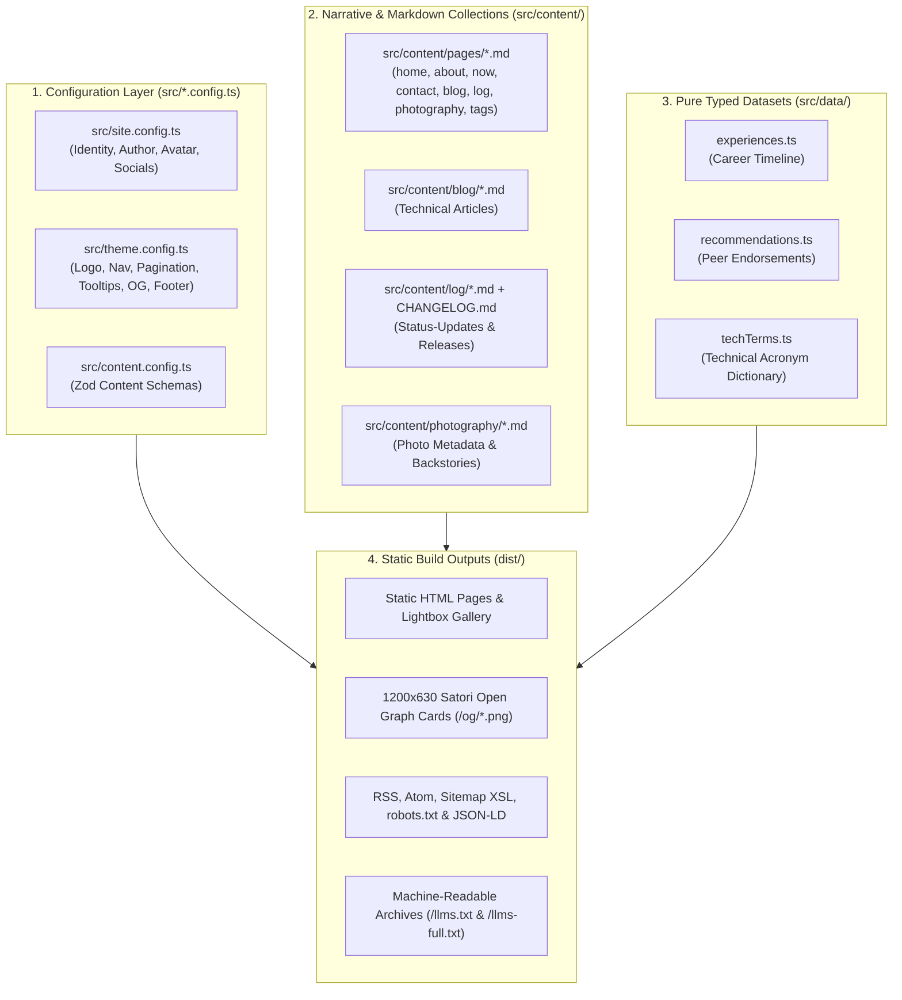

> [!NOTE]
> This is **Part 1** of a two-part setup guide. Part 1 covers **local setup, theme customization, and content authoring**. For optional multi-region AWS infrastructure, see [**Part 2 (Optional) — Provisioning & Deploying the Multi-Region AWS Stack with Terraform and GitLab CI/CD**](/blog/2026-11-03-part-2-provisioning-aws-mrap-cloudfront-terraform-gitlab-ci/).

This [Astro 7.4](/tags/astrojs/) and [Tailwind CSS v4](/tags/tailwind-css/) theme separates site configuration, Markdown content collections, and typed datasets from presentation templates. You can customize your identity, UI behavior, navigation, page copy, articles, career timeline, and photography—and even toggle individual features like the theme attribution link or "Powered by" links in the footer—without editing `.astro` files in `src/pages/` or `src/components/`.

---

## Architecture Overview: Configs, Content, and Datasets

The `src/` directory is organized into four layers:



- **`src/content/`** holds **Markdown collections** managed by Astro's Content Layer (`pages`, `blog`, `log`, `photography`). These files run through the Remark/Rehype pipeline (syntax highlighting, build-time Mermaid diagrams, GitHub-style alerts, and automatic acronym tooltips).
- **`src/data/`** holds **strongly-typed TypeScript datasets** (`experiences.ts`, `recommendations.ts`, `techTerms.ts`) queried and indexed across multiple routes at build time. Helper functions live in `src/utils/`, keeping `src/data/` data-only.

---

## Step 1: Local Prerequisites & Quickstart

To run and build the site locally, install **Node.js `>= 20`** and **Playwright's Chromium binary** (used by `rehype-mermaid` at build time to compile Markdown `mermaid` code fences into responsive inline SVGs with zero client-side JavaScript).

```bash
# 1. Install dependencies from package-lock.json
npm ci

# 2. Install headless Chromium for build-time Mermaid SVG rendering
npx playwright install chromium

# 3. Start the local dev server at http://localhost:4321
npm run dev
```

To run a full production build (generating static HTML, responsive WebP/AVIF photography variants, and build-time Satori Open Graph PNG cards):

```bash
npm run build
npm run preview
```

> [!TIP]
> **Warm Build Caching**: Both Astro's asset cache (`.cache/astro/`) and the SHA-256 content-addressed Open Graph card cache (`.cache/og-images/`) live outside `node_modules/`. While a cold build encoding all photography variants and OG cards takes ~45–60 seconds, subsequent warm builds finish in **~1.5 to 2.0 seconds**.

---

## Step 2: Configure Your Identity (`src/site.config.ts`)

`src/site.config.ts` defines site-wide metadata, author details, and social profiles:

```ts
export const siteConfig: SiteConfig = {
  site: {
    url: 'https://www.example.com',
    domain: 'example.com',
    title: 'Jane Doe',
    description:
      'Jane Doe — Systems & Cloud Architect. Notes on distributed systems, infrastructure automation, and photography.',
    keywords: ['Jane Doe', 'Cloud Architecture', 'Infrastructure', 'Linux', 'Terraform'],
    locale: 'en_US',
    defaultTheme: 'dark', // 'dark' | 'light' | 'system'
  },
  author: {
    name: 'Jane Doe',
    givenName: 'Jane',
    familyName: 'Doe',
    role: 'Systems & Cloud Architect',
    jobTitle: 'Principal Systems Architect',
    location: 'Tokyo',
    flagEmoji: '🇯🇵',
    email: 'jane@example.com',
    avatar: 'author.jpg',     // Small circular chip on blog & log cards
    aboutImage: 'author.jpg', // Large portrait on /about/ (can be a separate photo!)
    pronouns: 'she/her',
  },
  socials: {
    linkedin: { url: 'https://www.linkedin.com/in/jane-doe/', label: 'LinkedIn' },
    github:   { url: 'https://github.com/janedoe', label: 'GitHub' },
    gitlab:   { url: 'https://gitlab.com/janedoe', label: 'GitLab' },
    instagram:{ url: '', label: 'Instagram' }, // Leave empty ('') to hide automatically
  },
};
```

Updating `src/site.config.ts` automatically cascades across the entire build:
- **Astro Site URL**: Feeds `astro.config.mjs` for canonical URLs and `@astrojs/sitemap`.
- **Default Post Author**: `src/content.config.ts` defaults every blog post's `author` frontmatter field to `siteConfig.author.name`.
- **Headshots**: Drop your portrait into `src/images/author.jpg` (or configure two separate files in `src/images/` for `avatar` and `aboutImage`). Astro's asset pipeline automatically generates optimized AVIF and WebP variants.
- **Dynamic Endpoints**: `/rss.xml`, `/atom.xml`, `/robots.txt`, `/sitemap-style.xsl`, `/llms.txt`, `/llms-full.txt`, `/llms.json`, and Schema.org JSON-LD blocks all pull your name, domain, role, and social links directly from `siteConfig`.

---

## Step 3: Tune Theme & UI Mechanics (`src/theme.config.ts`)

`src/theme.config.ts` controls visual branding, third-party integrations, navigation, pagination, and build-time enhancements:

1. **Header SVG Wordmark (`logo`)**: Replace the inline SVG paths or adjust `viewBox`, `width`, and `height` for the top navbar logo.
2. **Third-Party Integrations (`integrations`)**:
   - **Formspree (`formspreeEndpoint`)**: Paste your Formspree form endpoint URL to activate the interactive contact forms on [`/contact/`](/contact/) and [`/about/#contact`](/about/#contact) (or set to `""` to disable).
   - **Umami Analytics (`analytics`)**: Toggle `enabled: true/false` and set your script URL and `websiteId`.
3. **Navigation & Pagination (`navigation`, `pagination`)**: Configure top navbar links and item counts per page for the blog archive (`olderBlogsCount`), log stream (`logCount`), photo gallery (`galleryCount`), and homepage carousels (`homepageCarouselCount`).
4. **Open Graph Card Branding (`openGraph`)**: Customize the badge label and footer text rendered onto every 1200×630 PNG social card generated by Satori at `/og/*.png`.
5. **Automatic Technical Tooltips (`tooltips`)**:
   - `enabled: true`
   - `autoLink: 'first'` (`'first' | 'all' | 'off'`) — When set to `'first'`, the build-time Rehype plugin (`rehype-tech-tooltips.mjs`) scans your Markdown articles in top-to-bottom reading order and automatically wraps **only the first occurrence** of any technical acronym found in `src/data/techTerms.ts` into an accessible glassmorphic tooltip card (both in light and dark mode), leaving subsequent mentions as clean plain text.
6. **Footer Toggles (`footer`)**: Customize the footer navigation columns, copyright notice, `showPoweredBy` badge, and `showThemeAttribution` toggle.

---

## Step 4: Edit Page Titles, Descriptions & Personal Narrative (`src/content/pages/`)

Every top-level page (`/` , `/about/`, `/now/`, `/contact/`, `/blog/`, `/log/`, `/photography/`, and `/tags/`) loads its `pageTitle`, meta `description`, headings, structured cards, and personal narrative prose from Markdown files in **`src/content/pages/`**:

| File | Route | What You Customize Here |
| :--- | :--- | :--- |
| `src/content/pages/home.md` | [`/`](/) | Homepage `pageTitle`, `description`, Intro hero card (`eyebrow`, `heading`, two-column blurb, CTA link), and section headers for the Photo Roll, Blog, and Log carousels. |
| `src/content/pages/about.md` | [`/about/`](/about/) | About `pageTitle`, `description`, greeting line, **Markdown body** (your personal biography paragraphs), spoken `languages` badges (`fluent`, `native`, `beginner`), `faq` accordion groups & answers, and contact form prompt. |
| `src/content/pages/now.md` | [`/now/`](/now/) | Your `/now` snapshot (`lastUpdated`, `introHtml`, and `nowSections` cards for Location, Engineering Focus, Homelab, Offline life, and Reading). Supports inline `<abbr>` tags for technical tooltips. |
| `src/content/pages/contact.md` | [`/contact/`](/contact/) | Contact `pageTitle`, `description`, heading, **Markdown body** (intro paragraph), timezone/response-time labels, and form header. |
| `src/content/pages/blog.md` | [`/blog/`](/blog/) | Blog index `pageTitle`, `description`, and archive section heading/subtitle. |
| `src/content/pages/log.md` | [`/log/`](/log/) | Log stream `pageTitle`, `description`, header badge, heading, and subtitle. |
| `src/content/pages/photography.md` | [`/photography/`](/photography/) | Photography gallery `pageTitle` and `description`. |
| `src/content/pages/tags.md` | [`/tags/`](/tags/) | Topic & tag directory `pageTitle`, `description`, eyebrow, heading, and subtitle. |

Because these files are validated by Zod in `src/content.config.ts`, Astro will immediately catch any missing or mistyped frontmatter fields during `npm run dev` or `npm run build`.

---

## Step 5: Populate Your Datasets (`src/data/`)

Three TypeScript files in `src/data/` power the interactive career timeline, peer recommendations, and technical dictionary:

1. **`src/data/experiences.ts`**: Powers the [Living CV timeline](/about/#experience) on `/about/` and automatically links career roles into matching topic archive pages under [`/tags/`](/tags/). Each entry includes `role`, `company`, `date`, `location`, `summary`, `highlights`, and `tags`.
2. **`src/data/recommendations.ts`**: Powers the symmetrical bento grid of peer recommendations on [`/about/#recommendations`](/about/#recommendations).
3. **`src/data/techTerms.ts`**: Contains ~60 categorized technical definitions (`Cloud`, `Networking`, `Storage`, `Security`, `Hardware`, `Virtualization`, `Architecture`, `DevOps`, `AI`). Add your own domain acronyms here and they will automatically upgrade to interactive tooltips across your blog posts with **zero client-side dictionary payload**.

---

## Step 6: Authoring Blog Posts, Logs & Photography

Once your identity and narrative pages are in place, day-to-day publishing happens entirely in Markdown:

### 1. Technical Articles (`src/content/blog/*.md`)

Create a new `.md` file in `src/content/blog/`:

```markdown
---
title: "Designing Resilient Multi-Region Storage"
description: "Practical notes on replication topologies, RPO/RTO trade-offs, and automated failover testing."
pubDate: "Nov 03 2026"
tags: ["AWS", "Infrastructure", "Architecture"]
sectionNav: "h1 to h2"
---
```

- **No `author` line needed**: Defaults automatically to `siteConfig.author.name`.
- **Floating Section Navigation (`sectionNav`)**: Adding `sectionNav: "h1 to h2"` (or `true`) automatically extracts your article's headings at build time and populates the floating sub-navigation pill bar.
- **Rich Markdown Extensions**:
  - **GitHub Alerts**: Use `> [!NOTE]`, `> [!TIP]`, `> [!IMPORTANT]`, `> [!WARNING]`, or `> [!CAUTION]`.
  - **Mermaid Diagrams**: Standard ` ```mermaid ` fences compile at build time into theme-adaptive inline SVGs.
  - **YouTube Facades**: Use a ` ```youtube ` code fence with a video URL on line 1 and title on line 2 to render a zero-tracking poster facade that also promotes the post to a `<VideoCardPoster />` in blog listings.

### 2. Operational Logs (`src/content/log/*.md` & `CHANGELOG.md`)

- **Status-Updates**: Drop short operational field notes into `src/content/log/YYYY-MM-DD-slug.md`.
- **Changelogs**: Maintain site release notes in the root `CHANGELOG.md` using Keep a Changelog headings (`## [YYYY-MM-DD] - Title`). The `/log/` stream parses `CHANGELOG.md` dynamically and merges releases with your status-updates and photo rolls.

### 3. Photography Roll (`src/images/photography/` & `src/content/photography/`)

- Place high-resolution source `.jpg` photos in `src/images/photography/` (e.g., `1.jpg`) and create a matching `src/content/photography/1.md` file with `id`, `filename`, `title`, `pubDate`, `category`, `location`, `tags`, and the backstory in the Markdown body.
- The build pipeline automatically generates responsive WebP thumbnails for the justified gallery grid, full-resolution WebP lightbox views, individual `/photography/[id]/` field-note pages, and 1200×630 Open Graph cards.

---

## Next Up: Deploying Your Static Build

Once `npm run build` completes, the static site is output to `./dist/`.

The `./dist/` directory can be deployed to any static hosting provider. To provision and deploy using the included multi-region <abbr>AWS</abbr> Terraform configuration and GitLab CI/CD pipeline, continue to [**Part 2 (Optional) — Provisioning & Deploying the Multi-Region AWS Stack with Terraform and GitLab CI/CD**](/blog/2026-11-03-part-2-provisioning-aws-mrap-cloudfront-terraform-gitlab-ci/).

