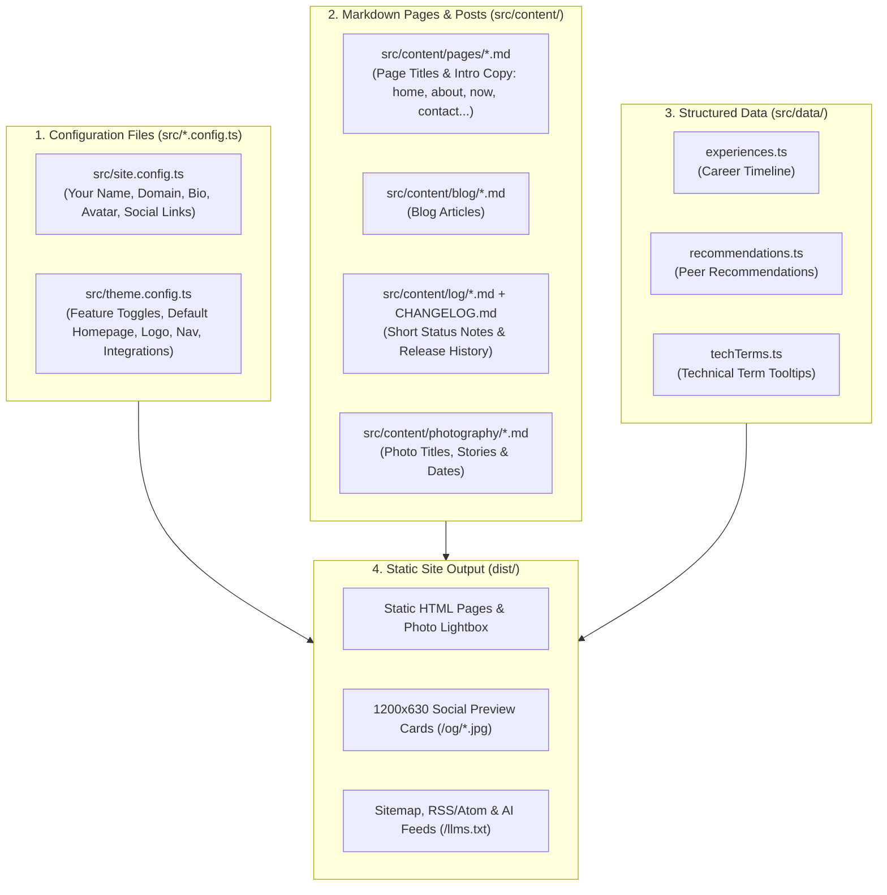

> [!NOTE]
> This is **Part 1** of a three-part guide on setting up and deploying **The Navigator** ([**GitHub (`edstuurman/the-navigator`)**](https://github.com/edstuurman/the-navigator) · [**GitLab (`src9061948/the-navigator`)**](https://gitlab.com/src9061948/the-navigator) · [**Live Interactive Demo**](https://the-navigator-sage.vercel.app/)):
> - **Part 1 (You are here)**: Local setup, identity, feature toggles, configurable homepage, and content authoring.
> - [**Part 2 (Optional) — Provisioning the Multi-Region AWS Stack with Terraform**](/blog/2026-11-03-part-2-provisioning-aws-mrap-cloudfront-terraform-gitlab-ci/): Setting up AWS S3, CloudFront, SSL certificates, and Route 53 DNS via GitLab CI, GitHub Actions, or Local CLI.
> - [**Part 3 — Automated CI/CD Pipelines & Deploying to Any Static Host**](/blog/2026-11-03-part-3-ci-cd-pipelines-dry-run-mode-and-static-hosting/): Zero-config deployment to Vercel, Netlify, or Cloudflare Pages, plus GitHub Actions & GitLab CI pipelines.

**The Navigator** is built around a simple rule: **you can customize 100% of your identity, layout, bio, blog posts, career timeline, and photo gallery—and turn entire sections (`blog`, `photography`, `log`, `now`, `about`, `tags`, `contact`, `contactForm`, `rss`, `llms`) on or off or choose which page serves as your `/` homepage—without ever opening an `.astro` template file.**

Here is how the configuration, content folders, and data files fit together—and the step-by-step guide to making the site your own.

---

## How the Project Is Organized

Instead of mixing personal content with layout code, `src/` is split into three simple layers that build your static site:



- **`src/*.config.ts`** controls **who owns the site** (`site.config.ts`) and **which features and integrations are enabled** (`theme.config.ts`).
- **`src/content/`** holds your **Markdown pages and posts** (`pages`, `blog`, `log`, `photography`), supporting diagrams, YouTube embeds, callout boxes, and automatic term tooltips.
- **`src/data/`** holds **structured lists** (`experiences.ts` for your career timeline, `recommendations.ts` for peer quotes, and `techTerms.ts` for hover definitions).

---

## Step 1: Local Prerequisites & Quickstart

Before cloning and running the theme locally, make sure you have:

- **Node.js `>= 20`** and `npm`
- **Playwright Chromium** *(used at build time to render Markdown Mermaid diagrams into crisp inline SVGs)*
- *(Optional)* **A [Formspree](https://formspree.io/) account (free)** — only needed if you want the embedded message form on `/contact/`, `/about/`, and blog posts. Set `features.contactForm: false` or leave the endpoint blank to use simple email and social links instead.
- *(Optional)* **An [Umami](https://umami.is/) account or self-hosted instance** — if you want privacy-friendly analytics (`integrations.umami` in `src/theme.config.ts`).
- *(Optional)* **A GitLab or GitHub account (free)** — for repository hosting and automated CI/CD builds.

Clone the starter repository from **GitHub** or **GitLab** and start the development server:

```bash
# 1. Clone from GitHub (or GitLab: https://gitlab.com/src9061948/the-navigator.git)
git clone https://github.com/edstuurman/the-navigator.git
cd the-navigator
npm ci

# 2. Install headless Chromium for build-time diagram rendering
npx playwright install chromium

# 3. Start the local dev server at http://localhost:4321
npm run dev
```

To run a full production build and preview the generated `./dist/` folder locally:

```bash
npm run build
npm run preview
```

> [!TIP]
> **Fast Warm Builds**: Optimized images and social preview cards are cached in `.cache/`. While the very first build takes ~45–60 seconds to process all sample photos and preview cards, subsequent builds finish in **~1.5 to 2 seconds**.

---

## Step 2: Configure Your Identity (`src/site.config.ts`)

Start by opening `src/site.config.ts`. This file holds your site URL, name, bio, portrait, and social links:

```ts
export const siteConfig: SiteIdentityConfig = {
  site: {
    url: 'https://www.example.com',
    domain: 'example.com',
    title: 'Alex Mercer',
    description:
      'Alex Mercer — Principal Cloud & Platform Architect. Distributed edge systems, multi-region AWS infrastructure, Terraform automation, and architectural photography.',
    locale: 'en_US',
    language: 'en-us',
    timeZone: 'America/Los_Angeles',
    defaultKeywords: [
      'Alex Mercer',
      'example.com',
      'Platform Architect',
      'Site Reliability Engineering',
      'Terraform',
      'AWS',
      'CloudFront',
      'Astro',
      'Tailwind CSS',
    ],
  },

  author: {
    name: 'Alex Mercer',
    alternateName: 'Alexander Mercer',
    avatar: 'author.jpg',     // Small circular chip on blog & log cards (src/images/author.jpg)
    aboutImage: 'author.jpg', // Large portrait on /about/ (can be a separate photo in src/images/)
    tagline: 'Cloud & Platform Architecture',
    jobTitle: 'Principal Cloud & Platform Architect',
    bio: 'Principal Cloud & Platform Architect specializing in multi-region edge infrastructure, declarative Terraform automation, high-throughput distributed systems, and architectural photography.',
    location: 'San Francisco, CA',
    email: 'alex@example.com',
    knowsAbout: [
      'Cloud Architecture',
      'AWS Multi-Region Infrastructure',
      'Terraform',
      'Site Reliability Engineering',
      'Linux Systems',
      'Edge Networking',
      'Static Web Architecture',
    ],
  },

  socials: {
    github: 'https://github.com',
    gitlab: 'https://gitlab.com',
    linkedin: 'https://www.linkedin.com',
    instagram: 'https://www.instagram.com',
    // Optional: twitter, bluesky, mastodon (omit or leave empty to hide)
  },
};
```

Updating `src/site.config.ts` automatically updates your name, domain, portrait (`src/images/author.jpg`), social links, RSS/Atom feeds, sitemap, and search engine metadata across every page.

---

## Step 3: Toggle Features & Choose Your Homepage (`src/theme.config.ts`)

Next, open `src/theme.config.ts` to choose which sections of the theme you want to use, which page acts as your front page, and how the interface looks:

```ts
export const themeMechanics: ThemeMechanicsConfig = {
  logo: {
    text: 'ALEX MERCER',
    ariaLabel: siteConfig.site.title,
    letterSpacing: '0.22em',
    fontSize: 14,
    showCompass: true,
    compassAngle: 42,
  },

  integrations: {
    formspree: {
      endpoint: 'https://formspree.io/f/your-form-id', // Optional: leave empty or set contactForm: false to hide
    },
    umami: {
      enabled: false,
      scriptUrl: 'https://cloud.umami.is/script.js',
      websiteId: '',
    },
  },

  navigation: {
    items: [
      { label: 'Home', href: '/', enabled: true },
      { label: 'About', href: '/about/', enabled: true },
      { label: 'Now', href: '/now/', enabled: true },
      { label: 'Blog', href: '/blog/', enabled: true, activePrefixes: ['/tags'] },
      { label: 'Photography', href: '/photography/', enabled: true },
      { label: 'Log', href: '/log/', enabled: true },
      { label: 'Contact', href: '/contact/', enabled: true },
    ],
  },

  features: {
    defaultHomePage: 'home', // 'home' | 'blog' | 'about' | 'now' | 'photography' | 'log' | 'tags' | 'contact'
    home: true,
    about: true,
    now: true,
    blog: true,
    photography: true,
    log: true,
    tags: true,
    contact: true,
    contactForm: true,
    rss: true,
    llms: true,
  },

  pagination: {
    olderBlogsCount: 20,
    logCount: 20,
    galleryCount: 50,
    homepageCarouselCount: 7,
  },

  openGraph: {
    brandLabel: 'ALEX MERCER',
    locationPinLabel: siteConfig.author.location,
  },

  tooltips: {
    enabled: true,
    autoLink: 'first', // 'first' | 'all' | 'off'
  },

  footer: {
    siteColumnTitle: 'Example.com',
    showPoweredBy: true,
    poweredByLinks: [
      { label: 'AWS S3', href: 'https://aws.amazon.com/s3/', icon: 's3' },
      { label: 'AWS MRAP', href: 'https://aws.amazon.com/s3/features/multi-region-access-points/', icon: 'mrap' },
      { label: 'AWS CloudFront', href: 'https://aws.amazon.com/cloudfront/', icon: 'cloudfront' },
      { label: 'Colophon', href: '/blog/2026-11-03-part-2-provisioning-aws-mrap-cloudfront-terraform-gitlab-ci/', icon: 'info', highlight: true },
    ],
    showThemeAttribution: false, // Set to `true` to display the optional footer credit
  },
};
```

### What You Can Toggle & Customize Here

1. **Turn Any Section On or Off (`features` & `navigation`)**:
   - Don't need a photography gallery, a `/now/` page, or an activity log? Set `photography: false` (or `enabled: false` on its item in `navigation.items`).
   - Turning a feature off removes it completely—skipping its pages at build time and automatically removing its navigation links, homepage carousel, `/log/` filter tab, `/tags/` section, sitemap entries, and RSS/AI feed items.
2. **Choose Your Front Page (`features.defaultHomePage`)**:
   - By default, `/` renders the multi-stream `home` overview with carousels.
   - Want your blog index or about page to be the front page of your site? Set `defaultHomePage: 'blog'` (or `'about'`, `'photography'`, `'log'`, `'now'`, `'tags'`, `'contact'`) and that section is rendered directly at `/`.
3. **Optional Contact Form & Feeds (`contactForm`, `rss`, `llms`)**:
   - **Formspree (`contactForm` & `integrations.formspree.endpoint`)**: Completely optional. Paste a free Formspree URL to enable the message form on [`/contact/`](/contact/), [`/about/#contact`](/about/#contact), and at the bottom of blog posts—or set `contactForm: false` (or leave `endpoint` blank) to hide the form and display your email and social links instead.
   - **RSS & AI Feeds (`rss`, `llms`)**: Set `rss: false` to disable `/rss.xml` and `/atom.xml`, or `llms: false` to disable `/llms.txt`, `/llms-full.txt`, and `/llms.json`.
   - **Umami Analytics (`integrations.umami`)**: Optional privacy-friendly analytics (`enabled: true/false`).
4. **Header Logo, Social Preview Cards & Tooltips (`logo`, `openGraph`, `tooltips`, `footer`)**:
   - **`logo`**: Change the SVG header text, font size, letter spacing, and compass icon.
   - **`openGraph`**: Set the `brandLabel` and `locationPinLabel` shown on generated 1200×630 social preview cards.
   - **`tooltips`**: Automatically turns the first mention of technical terms from `src/data/techTerms.ts` in each article into a hover/tap definition card (`autoLink: 'first' | 'all' | 'off'`).
   - **`footer`**: Customize footer links, toggle the "Powered by" column (`showPoweredBy`), or toggle the theme credit (`showThemeAttribution`).

---

## Step 4: Edit Page Titles & Intro Copy (`src/content/pages/`)

Every top-level page (`/`, `/about/`, `/now/`, `/contact/`, `/blog/`, `/log/`, `/photography/`, and `/tags/`) reads its title, description, headings, and intro copy from Markdown files in **`src/content/pages/`**:

| File | Route | What You Customize Here |
| :--- | :--- | :--- |
| `src/content/pages/home.md` | [`/`](/) | Homepage title, hero intro card, optional `setupGuide` quickstart banner, and carousel section titles. |
| `src/content/pages/about.md` | [`/about/`](/about/) | Your biography paragraphs (in the Markdown body), spoken `languages` badges, and `faq` accordion items. |
| `src/content/pages/now.md` | [`/now/`](/now/) | Your `/now` status cards (Location, Current Focus, Projects, Reading). |
| `src/content/pages/contact.md` | [`/contact/`](/contact/) | Contact page intro text, timezone/response-time labels, and form heading. |
| `src/content/pages/blog.md` | [`/blog/`](/blog/) | Blog page title, description, and archive heading. |
| `src/content/pages/log.md` | [`/log/`](/log/) | Activity log page title, description, and heading. |
| `src/content/pages/photography.md` | [`/photography/`](/photography/) | Photo gallery page title and description. |
| `src/content/pages/tags.md` | [`/tags/`](/tags/) | Topic index page title, description, and heading. |

> [!TIP]
> **Hiding the Starter Quickstart Banner on `/` (`setupGuide.enabled: false`)**: In **The Navigator** starter template, `src/content/pages/home.md` includes `setupGuide.enabled: true` to show the 3-step onboarding banner inside the homepage hero card. Set `enabled: false` under `setupGuide:` in `src/content/pages/home.md` whenever you're ready to hide it.

---

## Step 5: Update Your Career Timeline & Dictionaries (`src/data/`)

Three files in `src/data/` power the career timeline, peer recommendations, and term tooltips:

1. **`src/data/experiences.ts`**: Powers the [career timeline](/about/#experience) on `/about/` and links each role's `tags` to matching topic pages under [`/tags/`](/tags/).
2. **`src/data/recommendations.ts`**: Powers the peer recommendations grid on [`/about/#recommendations`](/about/#recommendations).
3. **`src/data/techTerms.ts`**: Holds ~60 technical term definitions (`Cloud`, `Networking`, `Storage`, `Security`, `Hardware`, `Virtualization`, `Architecture`, `DevOps`, `AI`) that automatically display hover/tap tooltips in your articles.

---

## Step 6: Adding Blog Posts, Logs & Photos

Day-to-day publishing happens in Markdown:

### 1. Blog Articles (`src/content/blog/*.md`)

Create a `.md` file in `src/content/blog/`:

```markdown
---
title: "Designing Resilient Multi-Region Storage"
description: "Practical notes on replication topologies, RPO/RTO trade-offs, and automated failover testing."
pubDate: "Nov 03 2026"
tags: ["AWS", "Infrastructure", "Architecture"]
sectionNav: "h1 to h2"
---
```

- **`sectionNav: "h1 to h2"`**: Automatically builds the floating table-of-contents bar from your article's headings.
- **Built-in Markdown Extras**:
  - **Callout Boxes**: Use `> [!NOTE]`, `> [!TIP]`, `> [!IMPORTANT]`, `> [!WARNING]`, or `> [!CAUTION]`.
  - **Diagrams**: Standard ` ```mermaid ` code blocks render as inline SVGs with a click-to-zoom lightbox.
  - **YouTube Videos**: Use a ` ```youtube ` code block (video URL on line 1, title on line 2) for a privacy-friendly click-to-play video card.

### 2. Activity Logs (`src/content/log/*.md` & `CHANGELOG.md`)

- **Short Status Notes**: Add Markdown files to `src/content/log/YYYY-MM-DD-slug.md`.
- **Release Notes**: Add release headings (`## [YYYY-MM-DD] - Title`) to root `CHANGELOG.md`. They automatically appear in the `/log/` timeline.

### 3. Photography (`src/images/photography/` & `src/content/photography/`)

- Drop `.jpg` photos into `src/images/photography/` (e.g., `1.jpg`) with a matching `src/content/photography/1.md` file containing `id`, `filename`, `title`, `pubDate`, `category`, `location`, `tags`, and optional story notes.

---

## Next Up: Choose Your Deployment Path

Once `npm run build` succeeds locally, your static site is ready in `./dist/`:

1. **Provision the Multi-Region AWS S3 + CloudFront Stack (Optional)**: Continue to [**Part 2 (Optional) — Provisioning the Multi-Region AWS Stack with Terraform**](/blog/2026-11-03-part-2-provisioning-aws-mrap-cloudfront-terraform-gitlab-ci/).
2. **Deploy to Any Static Host (Vercel, Netlify, Cloudflare Pages) or Explore CI/CD**: Jump to [**Part 3 — Automated CI/CD Pipelines & Deploying to Any Static Host**](/blog/2026-11-03-part-3-ci-cd-pipelines-dry-run-mode-and-static-hosting/).
