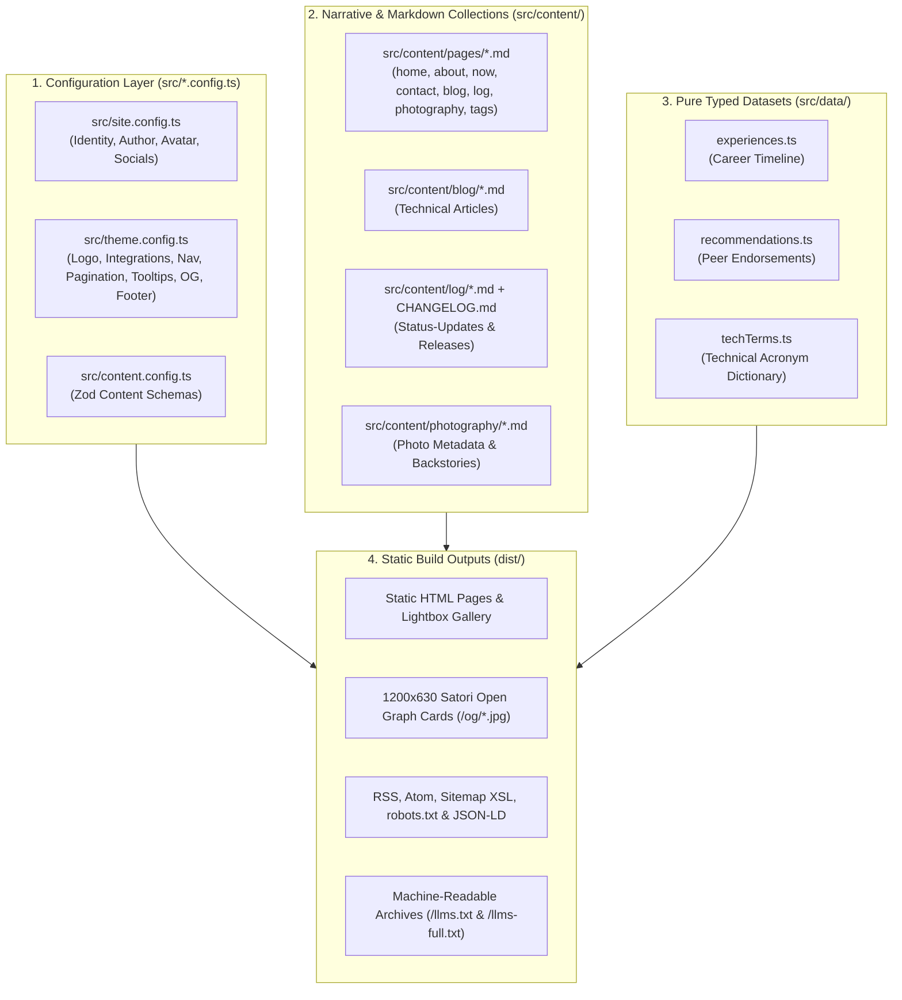

> [!NOTE]
> This is **Part 1** of a three-part guide on setting up and deploying this site from scratch. The open-source starter theme (**The Navigator**) is available on [**GitHub (`edstuurman/the-navigator`)**](https://github.com/edstuurman/the-navigator) and [**GitLab (`src9061948/the-navigator`)**](https://gitlab.com/src9061948/the-navigator), with a [**Live Interactive Demo on Vercel**](https://the-navigator-sage.vercel.app/):
> - **Part 1 (You are here)**: Local setup, identity & theme configuration, and content authoring.
> - [**Part 2 (Optional) — Provisioning the Multi-Region AWS Stack with Terraform**](/blog/2026-11-03-part-2-provisioning-aws-mrap-cloudfront-terraform-gitlab-ci/): Multi-region S3 buckets, MRAP, CloudFront SigV4a OAC, ACM SSL, and Route 53 DNS via GitLab CI, GitHub Actions, or Local CLI.
> - [**Part 3 — Automated CI/CD Pipelines, Starter Dry-Run Mode & Deploying to Any Static Host**](/blog/2026-11-03-part-3-ci-cd-pipelines-dry-run-mode-and-static-hosting/): Zero-config deployment to Vercel/Netlify/Cloudflare Pages, dual GitHub Actions & GitLab CI dry-run pipelines, and two-tier S3/CloudFront delta sync.

When I first built this site on [Astro 5](/tags/astrojs/) a year ago—before evolving it into the current **Astro 7.4** and **[Tailwind CSS v4](/tags/tailwind-css/)** theme—it started the way most personal engineering sites do: my name, domain, bio paragraphs, social links, and navigation items were scattered directly across a dozen `.astro` page templates, layout shells, and utility scripts.

That works fine when a repository only ever serves one person. It becomes a headache the moment you want to release the codebase as a clean, open-source starter theme—or even when you simply want to update your bio or domain metadata without grepping through layout components, Open Graph generators, RSS feeds, and JSON-LD blocks.

Over the past few days, we refactored the entire frontend architecture around a single rule: **a user adopting this theme should be able to customize 100% of their identity, UI mechanics, personal narrative, articles, career timeline, and photography—and even toggle individual features like the theme attribution link, optional Umami analytics, or "Powered by" links in the footer—without ever opening an `.astro` file in `src/pages/` or `src/components/`.**

Here is how the configuration, content collections, and datasets are structured—and the exact checklist to make this site your own.

---

## Architecture Overview: Configs, Content, and Datasets

Instead of mixing personal prose with presentation markup, the `src/` directory is divided into four distinct responsibilities:



Why separate `src/content/` from `src/data/`?

- **`src/content/`** holds **editorial prose and Markdown collections** managed by Astro's Content Layer (`pages`, `blog`, `log`, `photography`). These files go through the Unified Remark/Rehype pipeline (syntax highlighting, build-time Mermaid diagrams, GitHub-style alerts, and automatic acronym tooltips).
- **`src/data/`** holds **pure, strongly-typed TypeScript datasets** (`experiences.ts`, `recommendations.ts`, `techTerms.ts`) that are queried, cross-referenced, or indexed across multiple routes at build time. Helper logic lives in `src/utils/`, keeping `src/data/` 100% data-only.

---

## Step 1: Local Prerequisites & Quickstart

Before cloning and running the theme locally, make sure you have:

- **Node.js `>= 20`** (tested on Node 22 / 25) and `npm`
- **Playwright Chromium** (used at build time by `rehype-mermaid` to compile Markdown `mermaid` code fences into responsive inline SVGs with zero client-side JavaScript)
- **A GitLab or GitHub account (free)** (for repository hosting and automated CI/CD pipelines via `.gitlab-ci.yml` or `.github/workflows/deploy.yml`)
- **A Formspree account (free)** (for the static `/contact/` form submission endpoint configured in `src/theme.config.ts`)
- *(Optional)* **An Umami account** ([umami.is](https://umami.is/) or self-hosted) if you want privacy-friendly, cookie-free analytics (`integrations.umami` in `src/theme.config.ts`)

Clone the open-source starter repository from either **GitHub** or **GitLab**:

```bash
# 1. Clone from GitHub (or GitLab: https://gitlab.com/src9061948/the-navigator.git)
git clone https://github.com/edstuurman/the-navigator.git
cd the-navigator
npm ci

# 2. Install headless Chromium for build-time Mermaid SVG rendering
npx playwright install chromium

# 3. Start the local dev server at http://localhost:4321
npm run dev
```

When you are ready to test a full production build (including static HTML, responsive WebP/AVIF photography variants, and build-time Satori Open Graph PNG cards):

```bash
npm run build
npm run preview
```

> [!TIP]
> **Warm Build Caching**: Both Astro's asset cache (`.cache/astro/`) and our SHA-256 content-addressed Open Graph card cache (`.cache/og-images/`) live outside `node_modules/`. While a cold build encoding all photography variants and OG cards takes ~45–60 seconds, subsequent warm builds finish in **~1.5 to 2.0 seconds**.

---

## Step 2: Configure Your Identity (`src/site.config.ts`)

Your first stop when customizing the site is `src/site.config.ts`. This file is the single source of truth for **who owns the site**:

```ts
export const siteConfig: SiteIdentityConfig = {
  site: {
    url: 'https://www.example.com',
    domain: 'example.com',
    title: 'Alex Mercer',
    description:
      'Alex Mercer — Principal Cloud & Platform Architect. Distributed edge systems, multi-region AWS infrastructure, Terraform automation, and architectural photography.',
    locale: 'en_US',
    language: 'en-us',
    timeZone: 'America/Los_Angeles',
    defaultKeywords: [
      'Alex Mercer',
      'example.com',
      'Platform Architect',
      'Site Reliability Engineering',
      'Terraform',
      'AWS',
      'CloudFront',
      'Astro',
      'Tailwind CSS',
    ],
  },

  author: {
    name: 'Alex Mercer',
    alternateName: 'Alexander Mercer',
    avatar: 'author.jpg',     // Small circular chip on blog & log cards (src/images/author.jpg)
    aboutImage: 'author.jpg', // Large portrait on /about/ (can be a separate photo in src/images/)
    tagline: 'Cloud & Platform Architecture',
    jobTitle: 'Principal Cloud & Platform Architect',
    bio: 'Principal Cloud & Platform Architect specializing in multi-region edge infrastructure, declarative Terraform automation, high-throughput distributed systems, and architectural photography.',
    location: 'San Francisco, CA',
    email: 'alex@example.com',
    knowsAbout: [
      'Cloud Architecture',
      'AWS Multi-Region Infrastructure',
      'Terraform',
      'Site Reliability Engineering',
      'Linux Systems',
      'Edge Networking',
      'Static Web Architecture',
    ],
  },

  socials: {
    github: 'https://github.com',
    gitlab: 'https://gitlab.com',
    linkedin: 'https://www.linkedin.com',
    instagram: 'https://www.instagram.com',
    // Optional: twitter, bluesky, mastodon (omit or leave empty to hide)
  },
};
```

Updating `src/site.config.ts` automatically cascades across the entire build:
- **Astro Site URL**: Feeds `astro.config.mjs` for canonical URLs and `@astrojs/sitemap`.
- **Default Post Author**: `src/content.config.ts` defaults every blog post's `author` frontmatter field to `siteConfig.author.name`.
- **Headshots**: Drop your portrait into `src/images/author.jpg` (or configure two separate files in `src/images/` for `avatar` and `aboutImage`). Astro's asset pipeline automatically generates optimized AVIF and WebP variants.
- **Dynamic Endpoints**: `/rss.xml`, `/atom.xml`, `/robots.txt`, `/sitemap-style.xsl`, `/llms.txt`, `/llms-full.txt`, `/llms.json`, and Schema.org JSON-LD blocks all pull your name, domain, role, and social links directly from `siteConfig`.

---

## Step 3: Tune Theme & UI Mechanics (`src/theme.config.ts`)

Next, open `src/theme.config.ts` to customize **how the interface behaves and looks**:

```ts
export const themeMechanics: ThemeMechanicsConfig = {
  logo: {
    text: 'ALEX MERCER',
    ariaLabel: siteConfig.site.title,
    letterSpacing: '0.22em',
    fontSize: 14,
    showCompass: true,
    compassAngle: 42,
  },

  integrations: {
    formspree: {
      endpoint: 'https://formspree.io/f/your-form-id',
    },
    umami: {
      enabled: false,
      scriptUrl: 'https://cloud.umami.is/script.js',
      websiteId: '',
    },
  },

  navigation: {
    items: [
      { label: 'Home', href: '/', enabled: true },
      { label: 'About', href: '/about/', enabled: true },
      { label: 'Now', href: '/now/', enabled: true },
      { label: 'Blog', href: '/blog/', enabled: true, activePrefixes: ['/tags'] },
      { label: 'Photography', href: '/photography/', enabled: true },
      { label: 'Log', href: '/log/', enabled: true },
      { label: 'Contact', href: '/contact/', enabled: true },
    ],
  },

  pagination: {
    olderBlogsCount: 20,
    logCount: 20,
    galleryCount: 50,
    homepageCarouselCount: 7,
  },

  openGraph: {
    brandLabel: 'ALEX MERCER',
    locationPinLabel: siteConfig.author.location,
  },

  tooltips: {
    enabled: true,
    autoLink: 'first', // 'first' | 'all' | 'off'
  },

  footer: {
    siteColumnTitle: 'Example.com',
    showPoweredBy: true,
    poweredByLinks: [
      { label: 'AWS S3', href: 'https://aws.amazon.com/s3/', icon: 's3' },
      { label: 'AWS MRAP', href: 'https://aws.amazon.com/s3/features/multi-region-access-points/', icon: 'mrap' },
      { label: 'AWS CloudFront', href: 'https://aws.amazon.com/cloudfront/', icon: 'cloudfront' },
      { label: 'Colophon', href: '/blog/2026-11-03-part-2-provisioning-aws-mrap-cloudfront-terraform-gitlab-ci/', icon: 'info', highlight: true },
    ],
    showThemeAttribution: false, // Set to `true` to display the optional footer credit
  },
};
```

1. **Header SVG Wordmark (`logo`)**: Customize `text`, `letterSpacing`, `fontSize`, and whether the angled compass needle emblem (`showCompass`, `compassAngle`) appears on the underline.
2. **Third-Party Integrations (`integrations`)**:
   - **Formspree (`integrations.formspree.endpoint`)**: Paste your Formspree form endpoint URL (`https://formspree.io/f/...`) to activate the interactive contact forms on [`/contact/`](/contact/) and [`/about/#contact`](/about/#contact).
   - **Umami Analytics (`integrations.umami`)**: Optional privacy-friendly analytics. Toggle `enabled: true/false` and set your `scriptUrl` and `websiteId`.
3. **Navigation & Pagination (`navigation`, `pagination`)**: Configure top navbar links (`enabled: true | false`) and item counts per page for the blog archive (`olderBlogsCount`), log stream (`logCount`), photo gallery (`galleryCount`), and homepage carousels (`homepageCarouselCount`).
4. **Open Graph Card Branding (`openGraph`)**: Customize `brandLabel` and `locationPinLabel` rendered onto every 1200×630 JPEG social card generated by Satori at `/og/*.jpg`.
5. **Automatic Technical Tooltips (`tooltips`)**:
   - `enabled: true`
   - `autoLink: 'first'` (`'first' | 'all' | 'off'`) — When set to `'first'`, the build-time Rehype plugin (`src/plugins/rehype-tech-tooltips.mjs`) scans your Markdown articles in top-to-bottom reading order and automatically wraps **only the first occurrence** of any technical acronym found in `src/data/techTerms.ts` into an accessible glassmorphic tooltip card (both in light and dark mode), leaving subsequent mentions as clean plain text.
6. **Footer Toggles (`footer`)**: Customize `siteColumnTitle`, `showPoweredBy`, `poweredByLinks`, and `showThemeAttribution`.

---

## Step 4: Edit Page Titles, Descriptions & Personal Narrative (`src/content/pages/`)

Every top-level page (`/` , `/about/`, `/now/`, `/contact/`, `/blog/`, `/log/`, `/photography/`, and `/tags/`) loads its `pageTitle`, meta `description`, headings, structured cards, and personal narrative prose from Markdown files in **`src/content/pages/`**:

| File | Route | What You Customize Here |
| :--- | :--- | :--- |
| `src/content/pages/home.md` | [`/`](/) | Homepage `pageTitle`, `description`, Intro hero card (`eyebrow`, `heading`, two-column blurb, CTA link), optional `setupGuide` quickstart cards, and section headers for the Photo Roll, Blog, and Log carousels. |
| `src/content/pages/about.md` | [`/about/`](/about/) | About `pageTitle`, `description`, greeting line, **Markdown body** (your personal biography paragraphs), spoken `languages` badges (`fluent`, `native`, `beginner`), `faq` accordion groups & answers, and contact form prompt. |
| `src/content/pages/now.md` | [`/now/`](/now/) | Your `/now` snapshot (`lastUpdated`, `introHtml`, and `nowSections` cards for Location, Engineering Focus, Homelab, Offline life, and Reading). Supports inline `<abbr>` tags for technical tooltips. |
| `src/content/pages/contact.md` | [`/contact/`](/contact/) | Contact `pageTitle`, `description`, heading, **Markdown body** (intro paragraph), timezone/response-time labels, and form header. |
| `src/content/pages/blog.md` | [`/blog/`](/blog/) | Blog index `pageTitle`, `description`, and archive section heading/subtitle. |
| `src/content/pages/log.md` | [`/log/`](/log/) | Log stream `pageTitle`, `description`, header badge, heading, and subtitle. |
| `src/content/pages/photography.md` | [`/photography/`](/photography/) | Photography gallery `pageTitle` and `description`. |
| `src/content/pages/tags.md` | [`/tags/`](/tags/) | Topic & tag directory `pageTitle`, `description`, eyebrow, heading, and subtitle. |

Because these files are validated by Zod in `src/content.config.ts`, Astro will immediately catch any missing or mistyped frontmatter fields during `npm run dev` or `npm run build`.

> [!TIP]
> **Toggling Off the Starter Quickstart Banner on `/` (`setupGuide.enabled: false`)**: By default in **The Navigator**, `src/content/pages/home.md` includes a `setupGuide` block with `enabled: true` that displays the 3-step onboarding cards inside the homepage hero section. Once you finish setting up your site, simply set `enabled: false` under `setupGuide:` in `src/content/pages/home.md` (or delete the `setupGuide:` block) and the hero card automatically collapses to a clean personal introduction.

---

## Step 5: Populate Your Datasets (`src/data/`)

Three TypeScript files in `src/data/` power the interactive career timeline, peer recommendations, and technical dictionary:

1. **`src/data/experiences.ts`**: Powers the [Living CV timeline](/about/#experience) on `/about/` and automatically links career roles into matching topic archive pages under [`/tags/`](/tags/). Each entry includes `role`, `company`, `date`, `location`, `summary`, `highlights`, and `tags`.
2. **`src/data/recommendations.ts`**: Powers the symmetrical bento grid of peer recommendations on [`/about/#recommendations`](/about/#recommendations).
3. **`src/data/techTerms.ts`**: Contains ~60 categorized technical definitions (`Cloud`, `Networking`, `Storage`, `Security`, `Hardware`, `Virtualization`, `Architecture`, `DevOps`, `AI`). Add your own domain acronyms here and they will automatically upgrade to interactive tooltips across your blog posts with **zero client-side dictionary payload**.

---

## Step 6: Authoring Blog Posts, Logs & Photography

Once your identity and narrative pages are in place, day-to-day publishing happens entirely in Markdown:

### 1. Technical Articles (`src/content/blog/*.md`)

Create a new `.md` file in `src/content/blog/`:

```markdown
---
title: "Designing Resilient Multi-Region Storage"
description: "Practical notes on replication topologies, RPO/RTO trade-offs, and automated failover testing."
pubDate: "Nov 03 2026"
tags: ["AWS", "Infrastructure", "Architecture"]
sectionNav: "h1 to h2"
---
```

- **No `author` line needed**: Defaults automatically to `siteConfig.author.name`.
- **Floating Section Navigation (`sectionNav`)**: Adding `sectionNav: "h1 to h2"` (or `true`) automatically extracts your article's headings at build time and populates the floating sub-navigation pill bar (docked at the top on desktop and bottom on mobile).
- **Rich Markdown Extensions**:
  - **GitHub Alerts**: Use `> [!NOTE]`, `> [!TIP]`, `> [!IMPORTANT]`, `> [!WARNING]`, or `> [!CAUTION]`.
  - **Mermaid Diagrams**: Standard ` ```mermaid ` fences compile at build time into theme-adaptive inline SVGs.
  - **YouTube Facades**: Use a ` ```youtube ` code fence with a video URL on line 1 and title on line 2 to render a zero-tracking poster facade that also promotes the post to a `<VideoCardPoster />` in blog listings.

### 2. Operational Logs (`src/content/log/*.md` & `CHANGELOG.md`)

- **Status-Updates**: Drop short operational field notes into `src/content/log/YYYY-MM-DD-slug.md`.
- **Changelogs**: Maintain site release notes in the root `CHANGELOG.md` using Keep a Changelog headings (`## [YYYY-MM-DD] - Title`). The `/log/` stream parses `CHANGELOG.md` dynamically and merges releases with your status-updates and photo rolls.

### 3. Photography Roll (`src/images/photography/` & `src/content/photography/`)

- Place high-resolution source `.jpg` photos in `src/images/photography/` (e.g., `1.jpg`) and create a matching `src/content/photography/1.md` file with `id`, `filename`, `title`, `pubDate`, `category`, `location`, `tags`, and the backstory in the Markdown body.
- The build pipeline automatically generates responsive WebP thumbnails for the justified gallery grid, full-resolution WebP lightbox views, individual `/photography/[id]/` field-note pages, and 1200×630 Open Graph cards.

---

## Next Up: Choose Your Deployment Path

Once `npm run build` succeeds locally with your customized config and content, you have a complete static site in `./dist/`. From here, you can choose between two paths:

1. **Provision the Multi-Region AWS S3 MRAP + CloudFront Stack (Optional)**: Continue to [**Part 2 (Optional) — Provisioning the Multi-Region AWS Stack with Terraform (GitLab CI, GitHub Actions & Local CLI)**](/blog/2026-11-03-part-2-provisioning-aws-mrap-cloudfront-terraform-gitlab-ci/).
2. **Deploy to Any Static Host (Vercel, Netlify, Cloudflare Pages) or Explore the CI/CD Pipelines**: Jump straight to [**Part 3 — Automated CI/CD Pipelines, Starter Dry-Run Mode & Deploying to Any Static Host**](/blog/2026-11-03-part-3-ci-cd-pipelines-dry-run-mode-and-static-hosting/).
