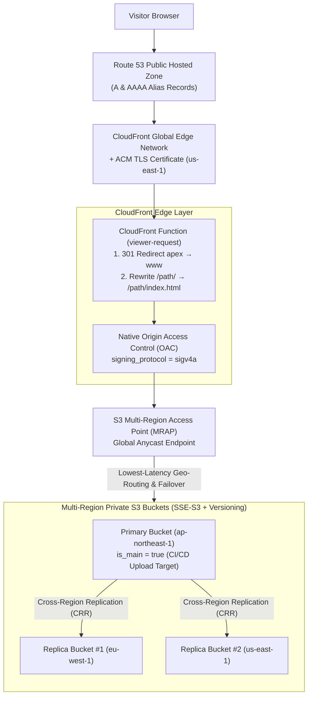
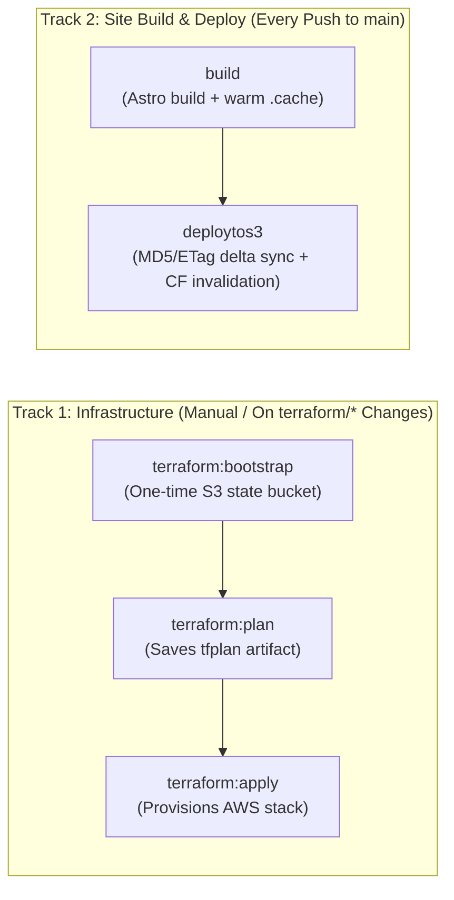

> [!NOTE]
> This is **Part 2 (Optional)** of a three-part setup and deployment guide for **The Navigator** ([**GitHub**](https://github.com/edstuurman/the-navigator) · [**GitLab**](https://gitlab.com/src9061948/the-navigator) · [**Live Demo**](https://the-navigator-sage.vercel.app/)):
> - [**Part 1 — Customizing This Astro Theme**](/blog/2026-11-03-part-1-customizing-this-astro-theme/): Local setup, identity & theme configuration, and content authoring.
> - **Part 2 (Optional — You are here)**: Provisioning the multi-region AWS S3 MRAP + CloudFront SigV4a stack with Terraform.
> - [**Part 3 — Automated CI/CD Pipelines, Starter Dry-Run Mode & Deploying to Any Static Host**](/blog/2026-11-03-part-3-ci-cd-pipelines-dry-run-mode-and-static-hosting/): Zero-config deployment to Vercel/Netlify/Cloudflare Pages, dual GitHub Actions & GitLab CI dry-run pipelines, and two-tier S3/CloudFront delta sync.

> [!IMPORTANT]
> **⏱️ Automated Provisioning — Expect ~20–30 Minutes for First-Time Greenfield Creation**:
> While the entire infrastructure stack is automated via Terraform, provisioning from zero for the first time typically takes **20 to 30 minutes** end-to-end inside AWS:
> - **ACM TLS Certificate DNS Validation (`us-east-1`)**: ~2–5 minutes
> - **S3 Multi-Region Access Point (`aws_s3control_multi_region_access_point`)**: **~10–20 minutes** (AWS provisions global anycast routing tables and cross-region control plane endpoints behind the scenes)
> - **CloudFront Global Edge Distribution + MRAP Policy Attachment**: ~5–10 minutes
>
> Grab a coffee during your initial `terraform apply`—subsequent runs and site deployments (`scripts/s3-deploy.sh`) complete in **~10–15 seconds**.

The `terraform/` directory provisions an optional, enterprise-grade multi-region AWS static hosting stack built around four core capabilities:

1. **Native CloudFront SigV4a Origin Access Control (OAC)**: CloudFront signs requests directly to the S3 Multi-Region Access Point (MRAP) origin using `signing_protocol = "sigv4a"`, requiring zero `Lambda@Edge` functions.
2. **CloudFront Function (`viewer-request`)**: Handles apex-to-`www` `301` redirects (`example.com` → `https://www.example.com`) and static directory index rewrites (`/about/` → `/about/index.html`) at the edge.
3. **Managed Security Response Headers (`Managed-SecurityHeadersPolicy`)**: Attaches AWS's managed security headers policy (`Strict-Transport-Security`, `X-Content-Type-Options: nosniff`, `X-Frame-Options: SAMEORIGIN`, `Referrer-Policy`, and `X-XSS-Protection`) at the CloudFront edge.
4. **Terraform `>= 1.10` Native S3 State Locking & AWS Provider `~> 6.0`**: Remote state locking uses native S3 `.tflock` lockfiles (`use_lockfile = true` without DynamoDB), and multi-region S3 buckets use the AWS Provider 6.0 per-resource `region` attribute.

---

## Multi-Region Request & Replication Topology

When deployed, your static site is replicated across your chosen AWS regions and served globally from the nearest healthy S3 bucket behind CloudFront:



---

## Choose Your Deployment Path

You can provision and manage this Terraform stack using whichever workflow fits your setup:

| Path | Best For | How It Runs |
| :--- | :--- | :--- |
| **[Option A — GitLab CI/CD](#step-2a-provision-via-gitlab-cicd-option-a)** | Teams & individuals hosting their repo on **GitLab** | Built-in `.gitlab-ci.yml` manual jobs (`terraform:bootstrap` → `terraform:plan` → `terraform:apply`) |
| **[Option B — GitHub Actions](#step-2b-provision-via-github-actions-option-b)** | Teams & individuals hosting their repo on **GitHub** | One-time `terraform/bootstrap` initialization + `.github/workflows/deploy.yml` automated builds & S3 deploys |
| **[Option C — Local CLI](#step-2c-provision-via-local-cli-option-c)** | Engineers who prefer running Terraform & deployments directly from their workstation | Local `terraform init && terraform apply` + `bash ./scripts/s3-deploy.sh ./dist` |

---

## Prerequisites

Before running `terraform:bootstrap` or `terraform:apply`, make sure you have the following in place:

1. **An Active AWS Account**:
   - Standard AWS account with default regions enabled. *(Note: CloudFront OAC for S3 Multi-Region Access Points supports all 17 default-enabled AWS regions; opt-in regions are not supported by AWS for MRAP OAC.)*
2. **A Registered Domain Hosted on Amazon Route 53**:
   - Your root domain (e.g. `example.com`) must already exist as a **Public Hosted Zone** in Route 53 (whether registered directly through Route 53 or an external registrar).
   - **Verify Nameservers (`NS`) First**: If your domain was registered outside AWS, ensure its `NS` records at your registrar already point to the four Route 53 nameservers listed in your Hosted Zone. During `terraform apply`, `aws_acm_certificate_validation` waits for public DNS validation of the ACM TLS certificate (`example.com` and `*.example.com` in `us-east-1`); if your domain's nameservers don't delegate to Route 53 yet, certificate validation will wait until they do.
3. **AWS IAM Credentials (`AWS_ACCESS_KEY_ID` & `AWS_SECRET_ACCESS_KEY`)**:
   - An IAM User or CI/CD role with permissions to provision and manage:
     - **S3 & S3 Control**: Regional buckets, versioning, encryption, lifecycle rules, replication, and Multi-Region Access Points (`s3:*`, `s3control:*`)
     - **CloudFront**: Distributions, SigV4a Origin Access Control (OAC), and CloudFront Functions (`cloudfront:*`)
     - **ACM (`us-east-1`)**: Public SSL/TLS certificate creation and DNS validation (`acm:*`)
     - **Route 53**: Hosted Zone lookup plus ACM validation `CNAME` and `A` (IPv4) / `AAAA` (IPv6) Alias records (`route53:*`)
     - **IAM**: Creating and attaching the least-privilege S3 Cross-Region Replication role (`iam:CreateRole`, `iam:CreatePolicy`, `iam:AttachRolePolicy`, `iam:PassRole`)
4. **Your Site Domain Configured in `src/site.config.ts` ([Part 1](/blog/2026-11-03-part-1-customizing-this-astro-theme/))**:
   - Ensure `site.url` and `site.domain` in `src/site.config.ts` match your Route 53 domain so build-time canonical links, sitemaps, feeds, and Open Graph cards match your live infrastructure.

---

## Step 1: Select Your Active Regions & Domain (`terraform/variables.tf`)

Open `terraform/variables.tf` and inspect `variable "buckets"`. By default, all **17 default-enabled AWS regions** supported by S3 MRAP + CloudFront OAC are pre-listed so you can simply comment out (`#`) the regions you don't need:

```hcl
variable "buckets" {
  description = "List of regional S3 buckets behind the Multi-Region Access Point (MRAP)."
  type = list(object({
    region   = string
    is_main  = bool
    priority = optional(number)
  }))
  default = [
    # --- Primary Region (Deploy Target) ---
    { region = "ap-northeast-1", is_main = true },  # Asia Pacific (Tokyo)

    # --- Europe ---
    { region = "eu-north-1",     is_main = false }, # Europe (Stockholm)
    { region = "eu-west-1",      is_main = false }, # Europe (Ireland)

    # --- Americas ---
    { region = "us-east-1",      is_main = false }, # US East (N. Virginia)
    { region = "us-west-2",      is_main = false }, # US West (Oregon)
  ]
}
```

> [!IMPORTANT]
> **Choose Your Regions Before First Apply**: In AWS, S3 Multi-Region Access Point bucket membership is immutable after creation. Select the regions you want in `terraform/variables.tf` before running your initial `terraform apply`. Exactly one bucket must have `is_main = true`—this is the primary bucket where your CI/CD pipeline uploads build artifacts, which S3 Cross-Region Replication then fans out to all replica regions.

### Setting `environment_domain` (Naked Root Domain)

Whether you pass `environment_domain` via `terraform/terraform.tfvars` (`environment_domain = "example.com"`) or CI/CD variables (`TF_VAR_environment_domain = example.com`), **always set it to your naked root domain without `https://` or `www.`** (for example, `example.com` or `yourdomain.com`).

From that single value, Terraform automatically derives:
- Your S3 state bucket name (`example-com-tfstate`)
- Your regional S3 bucket names (`example-com-ap-northeast-1`, `example-com-eu-west-1`, etc.)
- Your ACM wildcard TLS certificate (`example.com` and `*.example.com`)
- Your canonical `https://www.example.com` primary URL and `301` edge redirect from `https://example.com`

---

## Step 2A: Provision via GitLab CI/CD (Option A)

The repository root `.gitlab-ci.yml` runs on two independent tracks so normal content commits never block on manual infrastructure jobs:



### 1. Add Initial Bootstrap & Provisioning Variables in GitLab

On a brand-new setup, your S3 buckets and CloudFront distribution do not exist yet—so you cannot set `S3_BUCKET` or `CLOUDFRONT_DISTRIBUTION_ID` upfront. Start by opening **Settings → CI/CD → Variables** in your GitLab project and adding only the credentials and domain needed to bootstrap remote state and run Terraform:

| Variable Key | Required? | Example / Default | Purpose |
| :--- | :--- | :--- | :--- |
| `AWS_ACCESS_KEY_ID` | **Required** | `AKIA...` | AWS IAM Access Key ID for Terraform & S3 deploys (Protected, Masked) |
| `AWS_SECRET_ACCESS_KEY` | **Required** | `wJalrXUtnFEMI/...` | AWS IAM Secret Access Key (Protected, Masked) |
| `TF_VAR_environment_domain` | **Required** | `example.com` | Naked root domain in Route 53 (no `https://` or `www.`); auto-derives `<domain-slug>-tfstate` |
| `AWS_DEFAULT_REGION` | Optional | `ap-northeast-1` *(default)* | Default AWS CLI region and fallback region for the `<domain-slug>-tfstate` bucket |
| `TF_VAR_environment_domain_slug` | Optional | `example-com` *(dots → hyphens)* | Custom prefix override for state bucket and main stack resource names |
| `TF_STATE_BUCKET` / `TF_STATE_REGION` | Optional | `<domain-slug>-tfstate` / `AWS_DEFAULT_REGION` | Explicit overrides if you want the Terraform state bucket named or hosted separately |

### 2. Bootstrap Remote State (`terraform:bootstrap` — One-Time Only)

In GitLab **Build → Pipelines** on `main`, click the play button (**▶**) on **`terraform:bootstrap`**. This creates the dedicated, versioned, SSE-S3 encrypted, TLS-enforced `<domain-slug>-tfstate` bucket (which also stores native Terraform `>= 1.10` `.tflock` lockfiles).

### 3. Plan & Apply the Multi-Region Stack (`terraform:plan` → `terraform:apply`)

1. Trigger **`terraform:plan`** (or push a change to `terraform/variables.tf`). Terraform initializes against your newly bootstrapped `<domain-slug>-tfstate` bucket, validates the configuration across your selected regions in `var.buckets`, and saves the `tfplan` artifact.
2. Review the planned resources in the job log, then click play (**▶**) on **`terraform:apply`** to provision the regional S3 buckets, cross-region replication IAM & rules, S3 Multi-Region Access Point, `us-east-1` ACM certificate, CloudFront distribution, and Route 53 `A`/`AAAA` records *(allow ~20–30 minutes on the first greenfield run)*.
3. At the end of the **`terraform:apply`** job log, Terraform prints your newly created resource identifiers:
   ```text
   Outputs:

   active_bucket_regions      = [ "ap-northeast-1", "eu-north-1", "eu-west-1", "us-east-1", "us-west-2" ]
   cloudfront_distribution_id = "E1A2B3C4D5E6F7"
   primary_upload_bucket      = "example-com-ap-northeast-1"
   primary_upload_region      = "ap-northeast-1"
   site_urls                  = [ "https://www.example.com", "https://example.com" ]
   ```

### 4. Add Deployment Target Variables & Run `deploytos3`

Return to **Settings → CI/CD → Variables** in GitLab and add the two post-provisioning variables from the `terraform:apply` output:

| Variable Key | Value Source (`terraform:apply` output) | Purpose |
| :--- | :--- | :--- |
| `S3_BUCKET` | `primary_upload_bucket` (e.g. `example-com-ap-northeast-1`) | Primary S3 bucket where `scripts/s3-deploy.sh` uploads `./dist` |
| `CLOUDFRONT_DISTRIBUTION_ID` | `cloudfront_distribution_id` (e.g. `E1A2B3C4D5E6F7`) | CloudFront distribution invalidated after S3 delta sync |

Click retry/play (**▶**) on **`deploytos3`** in your pipeline (or push a commit to `main`) to sync `./dist` to your primary S3 bucket and issue a targeted CloudFront cache invalidation.

---

## Step 2B: Provision via GitHub Actions (Option B)

If you host your repository on **GitHub**, the included `.github/workflows/deploy.yml` workflow handles automated Astro builds, S3 delta deployments, and Terraform validation.

### 1. Provision the Initial AWS Stack

Run the one-time Terraform bootstrap and initial apply from your terminal (or a GitHub Codespace) using your AWS credentials:

```bash
# 1. Create the dedicated S3 state bucket (one-time bootstrap)
cd terraform/bootstrap
terraform init
terraform apply -var="environment_domain=example.com"

# 2. Initialize and apply the main multi-region stack (~20-30 mins first run)
cd ..
cp terraform.tfvars.example terraform.tfvars
# Edit terraform.tfvars to set: environment_domain = "example.com"

terraform init \
  -backend-config="bucket=example-com-tfstate" \
  -backend-config="region=ap-northeast-1"

terraform apply
```

### 2. Configure GitHub Actions Secrets & Variables

Open your GitHub repository **Settings → Secrets and variables → Actions** and add:

**Repository Secrets**:
- `AWS_ACCESS_KEY_ID`: Your AWS IAM Access Key ID
- `AWS_SECRET_ACCESS_KEY`: Your AWS IAM Secret Access Key

**Repository Variables**:
- `TF_VAR_environment_domain`: `example.com`
- `AWS_DEFAULT_REGION`: `ap-northeast-1` (or your primary upload bucket region)
- `S3_BUCKET`: Value of `terraform output -raw primary_upload_bucket` (e.g. `example-com-ap-northeast-1`)
- `CLOUDFRONT_DISTRIBUTION_ID`: Value of `terraform output -raw cloudfront_distribution_id` (e.g. `E1A2B3C4D5E6F7`)

Once `S3_BUCKET` is set in GitHub Actions Variables, `.github/workflows/deploy.yml` automatically switches out of **Starter Template Dry-Run Mode** and builds + deploys your site on every push to `main`!

---

## Step 2C: Provision via Local CLI (Option C)

If you prefer provisioning and deploying directly from your workstation terminal without CI/CD:

```bash
# 1. Create the dedicated S3 state bucket (one-time bootstrap)
cd terraform/bootstrap
terraform init
terraform apply -var="environment_domain=example.com"

# 2. Initialize and apply the main multi-region stack (~20-30 mins first run)
cd ..
cp terraform.tfvars.example terraform.tfvars
# Edit terraform.tfvars to set: environment_domain = "example.com"

terraform init \
  -backend-config="bucket=example-com-tfstate" \
  -backend-config="region=ap-northeast-1"

terraform apply
```

Once `terraform apply` finishes, build and deploy `./dist` directly from your machine at any time using `scripts/s3-deploy.sh`:

```bash
npm run build

S3_BUCKET="$(terraform -chdir=terraform output -raw primary_upload_bucket)" \
CLOUDFRONT_DISTRIBUTION_ID="$(terraform -chdir=terraform output -raw cloudfront_distribution_id)" \
bash ./scripts/s3-deploy.sh ./dist
```

---

## Under the Hood: Key Terraform Resources

Key implementation details across `terraform/` and `scripts/s3-deploy.sh`:

### 1. Native SigV4a Origin Access Control & Managed Security Headers (`terraform/cloudfront.tf`)

`aws_cloudfront_origin_access_control` signs origin requests with `sigv4a` directly against the MRAP endpoint. Because an MRAP hostname ends in `.accesspoint.s3-global.amazonaws.com` rather than `.s3.<region>.amazonaws.com`, the distribution's `origin` block **must** include `custom_origin_config` alongside `origin_access_control_id` (omitting `custom_origin_config` causes Terraform to send `S3OriginConfig`, which CloudFront rejects with `The parameter Origin DomainName does not refer to a valid S3 bucket`):

```hcl
resource "aws_cloudfront_origin_access_control" "mrap_oac" {
  name                              = "${local.domain_slug}-mrap-oac"
  description                       = "Native SigV4a Origin Access Control for S3 Multi-Region Access Point"
  origin_access_control_origin_type = "s3"
  signing_behavior                  = "always"
  signing_protocol                  = "sigv4a"
}

# Inside aws_cloudfront_distribution.mrap_distribution:
origin {
  domain_name              = aws_s3control_multi_region_access_point.mrap.domain_name
  origin_id                = "mrap_origin_id"
  origin_access_control_id = aws_cloudfront_origin_access_control.mrap_oac.id

  custom_origin_config {
    http_port              = 80
    https_port             = 443
    origin_protocol_policy = "https-only"
    origin_ssl_protocols   = ["TLSv1.2"]
  }
}
```

In addition, `default_cache_behavior` attaches AWS's `Managed-SecurityHeadersPolicy` (`67f7725c-6f97-4210-82d7-5512b31e9d03`) so every response includes `Strict-Transport-Security`, `X-Content-Type-Options: nosniff`, `X-Frame-Options: SAMEORIGIN`, and `Referrer-Policy` headers automatically.

### 2. Apex Redirect & Directory Index Rewriting (`terraform/cloudfront.tf`)

Because an S3 Multi-Region Access Point uses the S3 REST API endpoint rather than the legacy S3 Website endpoint, requests for `/about/` do not automatically resolve to `/about/index.html` on the S3 side. The `viewer-request` CloudFront Function handles both canonical host redirection and directory index resolution at the edge:

```javascript
function handler(event) {
  var request = event.request;
  var host = request.headers.host ? request.headers.host.value : '';

  // 1. Canonical redirect: naked domain -> www
  if (host === 'example.com') {
    return {
      statusCode: 301,
      statusDescription: 'Moved Permanently',
      headers: {
        location: { value: 'https://www.example.com' + request.uri }
      }
    };
  }

  // 2. Static directory index rewrite
  var uri = request.uri;
  if (uri.endsWith('/')) {
    request.uri += 'index.html';
  } else if (!uri.includes('.')) {
    request.uri += '/index.html';
  }
  return request;
}
```

---

## Next Up: Automated CI/CD Dry-Run Workflows, Static Hosts & Two-Tier Edge Caching

Now that you know how the optional multi-region AWS stack is provisioned, continue to [**Part 3 — Automated CI/CD Pipelines, Starter Dry-Run Mode & Deploying to Any Static Host**](/blog/2026-11-03-part-3-ci-cd-pipelines-dry-run-mode-and-static-hosting/) for a deep-dive into:
- Deploying `./dist/` to zero-config platforms (**Vercel, Netlify, Cloudflare Pages**)
- How the dual **GitLab CI (`.gitlab-ci.yml`)** and **GitHub Actions (`.github/workflows/deploy.yml`)** pipelines run in **Starter Template Dry-Run Mode** out of the box
- How `scripts/s3-deploy.sh` uses **4-tier split Edge/Browser `Cache-Control` headers** and **MD5-vs-ETag delta sync** to keep CloudFront cache hit ratios near 100% while updating live pages in seconds.
