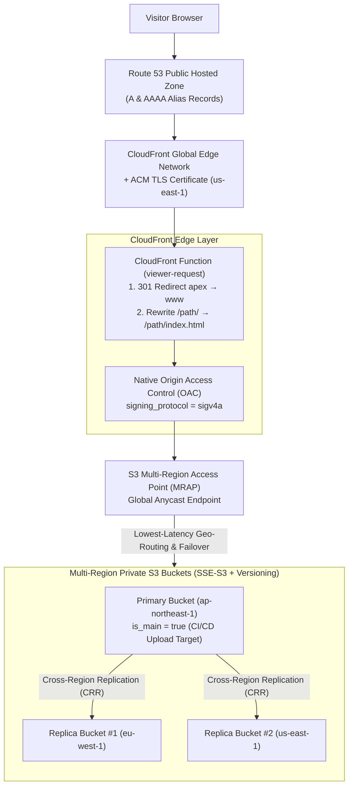
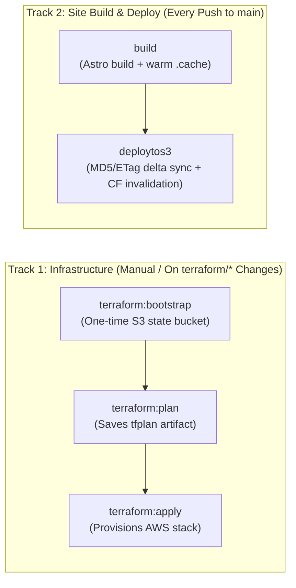

> [!NOTE]
> This is **Part 2 (Optional)** of a two-part setup guide. Because the build outputs standard static files to `./dist/`, you can deploy this theme to any static host—or follow this guide to provision the included multi-region AWS stack. For site identity, theme configuration, and content collections, see [**Part 1 — Customizing This Astro Theme: Separating Identity, Narrative, and Datasets from Templates**](/blog/2026-11-03-part-1-customizing-this-astro-theme/).

The `terraform/` directory and `.gitlab-ci.yml` pipeline provision a multi-region <abbr>AWS</abbr> static hosting stack built around three core capabilities:

1. **Native CloudFront SigV4a Origin Access Control (<abbr>OAC</abbr>)**: <abbr>CloudFront</abbr> signs requests directly to the <abbr>S3</abbr> Multi-Region Access Point (<abbr>MRAP</abbr>) origin using `signing_protocol = "sigv4a"`, requiring no `Lambda@Edge` functions.
2. **CloudFront Function (`viewer-request`)**: Handles apex-to-`www` `301` redirects (`example.com` → `https://www.example.com`) and static directory index rewrites (`/about/` → `/about/index.html`) at the edge.
3. **Terraform `>= 1.10` Native S3 State Locking & AWS Provider `~> 6.0`**: Remote state locking uses native S3 `.tflock` lockfiles (`use_lockfile = true` without DynamoDB), and multi-region S3 buckets use the AWS Provider 6.0 per-resource `region` attribute.

---

## Multi-Region Request & Replication Topology

When deployed, your static site is replicated across your chosen AWS regions and served globally from the nearest healthy S3 bucket behind CloudFront:



---

## Prerequisites

Before running `terraform:bootstrap` or `terraform:apply`, make sure you have the following in place:

1. **An Active AWS Account**:
   - Standard AWS account with default regions enabled. *(Note: CloudFront OAC for S3 Multi-Region Access Points supports all 17 default-enabled AWS regions; opt-in regions are not supported by AWS for MRAP OAC.)*
2. **A Registered Domain Hosted on Amazon Route 53**:
   - Your root domain (e.g. `example.com`) must already exist as a **Public Hosted Zone** in Route 53 (whether registered directly through Route 53 or an external registrar).
   - **Verify Nameservers (`NS`) First**: If your domain was registered outside AWS, ensure its `NS` records at your registrar already point to the four Route 53 nameservers listed in your Hosted Zone. During `terraform apply`, `aws_acm_certificate_validation` waits for public DNS validation of the <abbr>ACM</abbr> <abbr>TLS</abbr> certificate (`example.com` and `*.example.com` in `us-east-1`); if your domain's nameservers don't delegate to Route 53 yet, certificate validation will wait until they do.
3. **AWS IAM Credentials (`AWS_ACCESS_KEY_ID` & `AWS_SECRET_ACCESS_KEY`)**:
   - An IAM User or CI/CD role with permissions to provision and manage:
     - **S3 & S3 Control**: Regional buckets, versioning, encryption, lifecycle rules, replication, and Multi-Region Access Points (`s3:*`, `s3control:*`)
     - **CloudFront**: Distributions, SigV4a Origin Access Control (<abbr>OAC</abbr>), and CloudFront Functions (`cloudfront:*`)
     - **ACM (`us-east-1`)**: Public SSL/TLS certificate creation and DNS validation (`acm:*`)
     - **Route 53**: Hosted Zone lookup plus ACM validation `CNAME` and `A` (<abbr>IPv4</abbr>) / `AAAA` (<abbr>IPv6</abbr>) Alias records (`route53:*`)
     - **IAM**: Creating and attaching the least-privilege S3 Cross-Region Replication role (`iam:CreateRole`, `iam:CreatePolicy`, `iam:AttachRolePolicy`, `iam:PassRole`)
4. **A GitLab Account (Free Tier) — or Local CLI Tools**:
   - **Option A (GitLab CI/CD)**: A free GitLab account hosting your forked repository to run the built-in `.gitlab-ci.yml` pipeline.
   - **Option B (Local Terminal)**: **Terraform `>= 1.10.0`**, **AWS CLI v2**, and **Node.js `>= 20`** installed on your workstation.
5. **Your Site Domain Configured in `src/site.config.ts` ([Part 1](/blog/2026-11-03-part-1-customizing-this-astro-theme/))**:
   - Ensure `siteUrl` and `domain` in `src/site.config.ts` match your Route 53 domain so build-time canonical links, sitemaps, feeds, and Open Graph cards match your live infrastructure.

---

## Step 1: Select Your Active Regions in `terraform/variables.tf`

Open `terraform/variables.tf` and inspect `variable "buckets"`. By default, all **17 default-enabled AWS regions** supported by S3 MRAP + CloudFront OAC are pre-listed so you can simply comment out (`#`) the regions you don't need:

```hcl
variable "buckets" {
  description = "List of regional S3 buckets behind the Multi-Region Access Point (MRAP)."
  type = list(object({
    region   = string
    is_main  = bool
    priority = optional(number)
  }))
  default = [
    # --- Primary Region (Deploy Target) ---
    { region = "ap-northeast-1", is_main = true },  # Asia Pacific (Tokyo)

    # --- Europe ---
    { region = "eu-north-1",     is_main = false }, # Europe (Stockholm)
    { region = "eu-west-1",      is_main = false }, # Europe (Ireland)

    # --- Americas ---
    { region = "us-east-1",      is_main = false }, # US East (N. Virginia)
    { region = "us-west-2",      is_main = false }, # US West (Oregon)
  ]
}
```

> [!IMPORTANT]
> **Choose Your Regions Before First Apply**: In AWS, S3 Multi-Region Access Point bucket membership is immutable after creation. Select the regions you want in `terraform/variables.tf` before running your initial `terraform apply`. Exactly one bucket must have `is_main = true`—this is the primary bucket where your CI/CD pipeline uploads build artifacts, which S3 Cross-Region Replication then fans out to all replica regions.

---

## Step 2: Provision Infrastructure (Option A — GitLab CI/CD)

The repository root `.gitlab-ci.yml` runs on two independent tracks so normal content commits never block on manual infrastructure jobs:



### 1. Add Initial Bootstrap & Provisioning Variables

On a brand-new setup, your S3 buckets and CloudFront distribution do not exist yet—so you cannot set `S3_BUCKET` or `CLOUDFRONT_DISTRIBUTION_ID` upfront. Start by opening **Settings → CI/CD → Variables** in your GitLab project and adding only the credentials and domain needed to bootstrap remote state and run Terraform:

| Variable Key | Required? | Example / Default | Purpose |
| :--- | :--- | :--- | :--- |
| `AWS_ACCESS_KEY_ID` | **Required** | `AKIA...` | AWS IAM Access Key ID for Terraform & S3 deploys (Protected, Masked) |
| `AWS_SECRET_ACCESS_KEY` | **Required** | `wJalrXUtnFEMI/...` | AWS IAM Secret Access Key (Protected, Masked) |
| `TF_VAR_environment_domain` | **Required** | `example.com` | Primary root domain in Route 53; auto-derives `<domain-slug>-tfstate` |
| `AWS_DEFAULT_REGION` | Optional | `ap-northeast-1` *(default)* | Default AWS CLI region and fallback region for the `<domain-slug>-tfstate` bucket |
| `TF_VAR_environment_domain_slug` | Optional | `example-com` *(dots → hyphens)* | Custom prefix override for state bucket and main stack resource names |
| `TF_STATE_BUCKET` / `TF_STATE_REGION` | Optional | `<domain-slug>-tfstate` / `AWS_DEFAULT_REGION` | Explicit overrides if you want the Terraform state bucket named or hosted separately |

### 2. Bootstrap Remote State (`terraform:bootstrap` — One-Time Only)

`terraform/bootstrap/` is a self-contained Terraform root module that does not depend on `terraform/variables.tf`—it only needs the initial variables above to provision the remote state backend.

In GitLab **Build → Pipelines** on `main`, click the play button (**▶**) on **`terraform:bootstrap`**. This creates the dedicated, versioned, SSE-S3 encrypted, TLS-enforced `<domain-slug>-tfstate` bucket (which also stores native Terraform `>= 1.10` `.tflock` lockfiles).

### 3. Plan & Apply the Multi-Region Stack (`terraform:plan` → `terraform:apply`)

1. Trigger **`terraform:plan`** (or push a change to `terraform/variables.tf`). Terraform initializes against your newly bootstrapped `<domain-slug>-tfstate` bucket, validates the configuration across your selected regions in `var.buckets`, and saves the `tfplan` artifact.
2. Review the planned resources in the job log, then click play (**▶**) on **`terraform:apply`** to provision the regional S3 buckets, cross-region replication IAM & rules, S3 Multi-Region Access Point, `us-east-1` ACM certificate, CloudFront distribution, and Route 53 `A`/`AAAA` records.
3. At the end of the **`terraform:apply`** job log, Terraform prints your newly created resource identifiers:
   ```text
   Outputs:

   active_bucket_regions      = [ "ap-northeast-1", "eu-north-1", "eu-west-1", "us-east-1", "us-west-2" ]
   cloudfront_distribution_id = "E1A2B3C4D5E6F7"
   primary_upload_bucket      = "example-com-ap-northeast-1"
   primary_upload_region      = "ap-northeast-1"
   site_urls                  = [ "https://www.example.com", "https://example.com" ]
   ```

### 4. Add Deployment Target Variables & Run `deploytos3`

Now that your primary S3 upload bucket and CloudFront distribution exist, return to **Settings → CI/CD → Variables** and add the two post-provisioning variables from the `terraform:apply` output:

| Variable Key | Value Source (`terraform:apply` output) | Purpose |
| :--- | :--- | :--- |
| `S3_BUCKET` | `primary_upload_bucket` (e.g. `example-com-ap-northeast-1`) | Primary S3 bucket where `scripts/s3-deploy.sh` uploads `./dist` |
| `CLOUDFRONT_DISTRIBUTION_ID` | `cloudfront_distribution_id` (e.g. `E1A2B3C4D5E6F7`) | CloudFront distribution invalidated after S3 delta sync |

Finally, click retry/play (**▶**) on **`deploytos3`** in your pipeline (or push a commit to `main`) to sync `./dist` to your primary S3 bucket and issue a targeted CloudFront cache invalidation.

---

## Step 3: Provision Infrastructure (Option B — Local CLI)

If you prefer provisioning from your workstation terminal instead of GitLab CI:

```bash
# 1. Create the dedicated S3 state bucket (one-time bootstrap)
cd terraform/bootstrap
terraform init
terraform apply -var="environment_domain=example.com"

# 2. Initialize and apply the main multi-region stack
cd ..
cp terraform.tfvars.example terraform.tfvars
# Edit terraform.tfvars to set: environment_domain = "example.com"

terraform init \
  -backend-config="bucket=example-com-tfstate" \
  -backend-config="region=ap-northeast-1"

terraform apply
```

Once `terraform apply` finishes, you can deploy `./dist` directly from your machine at any time using `scripts/s3-deploy.sh`:

```bash
npm run build

S3_BUCKET="$(terraform -chdir=terraform output -raw primary_upload_bucket)" \
CLOUDFRONT_DISTRIBUTION_ID="$(terraform -chdir=terraform output -raw cloudfront_distribution_id)" \
bash ./scripts/s3-deploy.sh ./dist
```

---

## Under the Hood: Key Terraform Resources

Key implementation details across `terraform/` and `scripts/s3-deploy.sh`:

### 1. Native SigV4a Origin Access Control (`terraform/cloudfront.tf`)

`aws_cloudfront_origin_access_control` signs origin requests with `sigv4a` directly against the MRAP endpoint. Because an MRAP hostname ends in `.accesspoint.s3-global.amazonaws.com` rather than `.s3.<region>.amazonaws.com`, the distribution's `origin` block **must** include `custom_origin_config` alongside `origin_access_control_id` (omitting `custom_origin_config` causes Terraform to send `S3OriginConfig`, which CloudFront rejects with `The parameter Origin DomainName does not refer to a valid S3 bucket`):

```hcl
resource "aws_cloudfront_origin_access_control" "mrap_oac" {
  name                              = "${local.domain_slug}-mrap-oac"
  description                       = "Native SigV4a Origin Access Control for S3 Multi-Region Access Point"
  origin_access_control_origin_type = "s3"
  signing_behavior                  = "always"
  signing_protocol                  = "sigv4a"
}

# Inside aws_cloudfront_distribution.mrap_distribution:
origin {
  domain_name              = aws_s3control_multi_region_access_point.mrap.domain_name
  origin_id                = "mrap_origin_id"
  origin_access_control_id = aws_cloudfront_origin_access_control.mrap_oac.id

  custom_origin_config {
    http_port              = 80
    https_port             = 443
    origin_protocol_policy = "https-only"
    origin_ssl_protocols   = ["TLSv1.2"]
  }
}
```

Both each regional S3 bucket policy and the Multi-Region Access Point policy lock down `s3:GetObject` strictly to `cloudfront.amazonaws.com` scoped to your `AWS:SourceArn` CloudFront distribution ARN. All S3 buckets and the MRAP itself have `block_public_acls`, `block_public_policy`, `ignore_public_acls`, and `restrict_public_buckets` enabled.

### 2. Apex Redirect & Directory Index Rewriting (`terraform/cloudfront.tf`)

Because an S3 Multi-Region Access Point uses the S3 REST API endpoint rather than the legacy S3 Website endpoint, requests for `/about/` do not automatically resolve to `/about/index.html` on the S3 side. The `viewer-request` CloudFront Function handles both canonical host redirection and directory index resolution at the edge:

```javascript
function handler(event) {
  var request = event.request;
  var host = request.headers.host ? request.headers.host.value : '';

  // 1. Canonical redirect: naked domain -> www
  if (host === 'example.com') {
    return {
      statusCode: 301,
      statusDescription: 'Moved Permanently',
      headers: {
        location: { value: 'https://www.example.com' + request.uri }
      }
    };
  }

  // 2. Static directory index rewrite
  var uri = request.uri;
  if (uri.endsWith('/')) {
    request.uri += 'index.html';
  } else if (!uri.includes('.')) {
    request.uri += '/index.html';
  }
  return request;
}
```

### 3. Delta-Only S3 Sync & Targeted Invalidations (`scripts/s3-deploy.sh`)

Standard `aws s3 sync` re-uploads every file after a static site build because freshly generated files have newer `mtime` timestamps.

`scripts/s3-deploy.sh` queries existing S3 object ETags via `aws s3api list-objects-v2`, compares them against local MD5 hashes, uploads **only files whose content changed**, and submits a targeted CloudFront invalidation (collapsing `/about/index.html` to `/about/*` and switching to a single `/*` wildcard if more than 15 paths changed).

