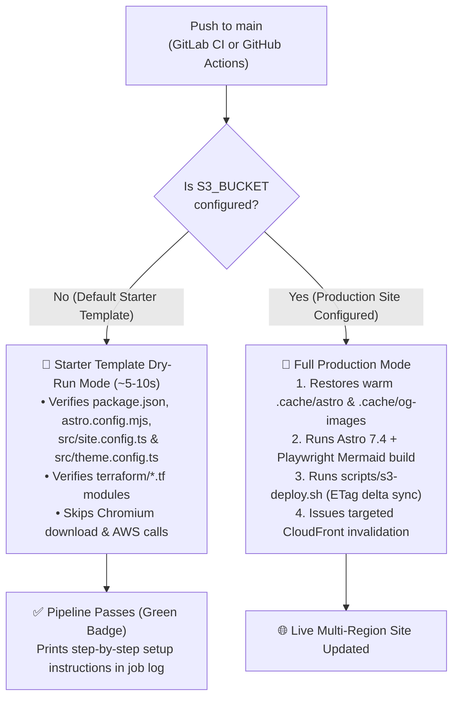
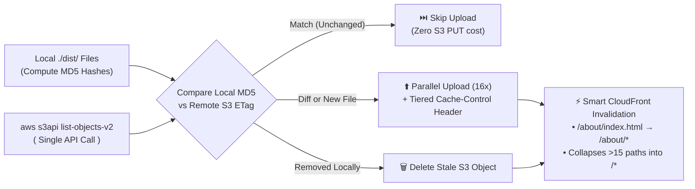

> [!NOTE]
> This is **Part 3** of a three-part setup and deployment guide for **The Navigator** ([**GitHub**](https://github.com/edstuurman/the-navigator) · [**GitLab**](https://gitlab.com/src9061948/the-navigator) · [**Live Demo**](https://the-navigator-sage.vercel.app/)):
> - [**Part 1 — Customizing This Astro Theme**](/blog/2026-11-03-part-1-customizing-this-astro-theme/): Local setup, identity & theme configuration, and content authoring.
> - [**Part 2 (Optional) — Provisioning the Multi-Region AWS Stack with Terraform**](/blog/2026-11-03-part-2-provisioning-aws-mrap-cloudfront-terraform-gitlab-ci/): Multi-region S3 buckets, MRAP, CloudFront SigV4a OAC, ACM SSL, and Route 53 DNS via GitLab CI, GitHub Actions, or Local CLI.
> - **Part 3 (You are here)**: Deploying to zero-config static hosts (Vercel, Netlify, Cloudflare Pages), dual GitHub Actions & GitLab CI Starter Dry-Run pipelines, and 4-tier S3/CloudFront delta sync.

Because this theme compiles 100% of its pages, responsive WebP/AVIF photography variants, inline SVG Mermaid diagrams, Satori Open Graph social cards, and machine-readable `/llms.txt` indexes at build time into `./dist/` (`output: 'static'`), **you are never locked into a single cloud provider**.

In this final part of the setup series, we cover:
1. How to deploy `./dist/` to zero-config static hosts like **Vercel**, **Netlify**, or **Cloudflare Pages** in under a minute (just like the [Live Interactive Demo](https://the-navigator-sage.vercel.app/)).
2. How the repository's dual **GitLab CI (`.gitlab-ci.yml`)** and **GitHub Actions (`.github/workflows/deploy.yml`)** pipelines use **Starter Template Dry-Run Mode** so fresh forks get green `✅` status badges in ~5–10 seconds without needing AWS credentials upfront.
3. How `scripts/s3-deploy.sh` combines **MD5-vs-ETag delta sync** with **4-tier split Edge/Browser `Cache-Control` headers** so live pages update in seconds while CloudFront edge cache hit ratios stay near 100%.

---

## Option 1: Zero-Config Static Hosting (Vercel, Netlify, Cloudflare Pages)

If you don't need multi-region <abbr>AWS</abbr> <abbr>S3</abbr> replication ([Part 2](/blog/2026-11-03-part-2-provisioning-aws-mrap-cloudfront-terraform-gitlab-ci/)), you can host the compiled `./dist/` folder on any static <abbr>CDN</abbr> with zero infrastructure setup:

### A. Prebuilt Static Upload (Fastest — Zero Cloud Build Minutes)

Because `npm run build` generates a self-contained `./dist/` directory locally (including pre-rendered inline SVG Mermaid diagrams and cached 1200×630 Open Graph cards), you can upload `./dist/` directly to Vercel, Netlify Drop, or Cloudflare Pages:

```bash
# 1. Build the static site locally into ./dist/
npm run build

# 2. Deploy ./dist/ directly (e.g. Vercel CLI, Netlify CLI, or Cloudflare Wrangler)
npx vercel deploy ./dist --prod
# or: npx netlify-cli deploy --dir=./dist --prod
# or: npx wrangler pages deploy ./dist
```

### B. Automated Git Integration on Vercel / Netlify / Cloudflare Pages

If you connect your GitHub or GitLab repository directly to Vercel, Netlify, or Cloudflare Pages, configure the build settings to install Playwright's headless Chromium binary before running `npm run build` (required by `rehype-mermaid` to compile Markdown `mermaid` fences into inline SVGs):

| Setting | Value |
| :--- | :--- |
| **Framework Preset** | `Astro` |
| **Build Command** | `npx playwright install chromium && npm run build` |
| **Output Directory** | `dist` |
| **Node.js Version** | `22.x` (or `>= 20`) |

---

## Option 2: Dual CI/CD Pipelines with Starter Template Dry-Run Mode

A common frustration with open-source starter templates that include production CI/CD workflows is the **"Red Pipeline on First Fork" problem**: the moment you fork or push the starter repository to GitHub or GitLab, the CI pipeline tries to authenticate with AWS or run `aws s3 sync`, fails because you haven't configured cloud secrets yet, and plasters red `❌` failure badges across your repository.

To solve this cleanly, both **`.gitlab-ci.yml`** (GitLab CI/CD) and **`.github/workflows/deploy.yml`** (GitHub Actions) in **The Navigator** implement **automatic Starter Template Dry-Run Mode**:



### How Dry-Run Mode Works Under the Hood

When `S3_BUCKET` is empty (the default on a fresh clone or fork):
1. **Build & Deploy Jobs (`build`, `deploytos3`)**: Instead of spinning up a 2 GB headless browser container or failing on missing AWS credentials, the runner verifies that `package.json`, `astro.config.mjs`, `src/site.config.ts`, `src/theme.config.ts`, and `scripts/s3-deploy.sh` are intact, prints a concise onboarding guide in the job log, and exits `0` in **~5–10 seconds**.
2. **Infrastructure Check (`terraform:dry-run`)**: When `TF_VAR_environment_domain` is unset, a lightweight dry-run job verifies that all Terraform modules (`terraform/versions.tf`, `terraform/backend.tf`, `terraform/cloudfront.tf`, `terraform/s3-mrap.tf`, `terraform/acm-route53.tf`, and `terraform/bootstrap/main.tf`) are present and passes with a green `✅` badge.
3. **Zero-Edit Transition to Production**: The moment you add `S3_BUCKET` (and your AWS credentials) in **GitLab CI/CD Variables** or **GitHub Actions Secrets & Variables**, the exact same workflow automatically transitions to full production builds and S3 delta deployments—without editing a single line of `.gitlab-ci.yml` or `.github/workflows/deploy.yml`.

### Enabling Automated CI/CD on Your Fork

To prevent consuming shared runner minutes and avoid redundant builds on the public demo template, automated CI is intentionally disabled on the upstream `the-navigator` repository (`src9061948/the-navigator` / `edstuurman/the-navigator`). CI runs only on the production site (`stuurman`).

When you fork or clone the theme for your own site, here is the exact one-time interaction to enable automated builds:

#### A. For GitLab CI/CD (`.gitlab-ci.yml`)
- **Renamed Projects (Default)**: If you rename your repository to your own domain or project name (e.g. `my-awesome-site`), GitLab CI runs automatically out of the box.
- **Projects Retaining "navigator"**: If your fork retains `navigator` in its project name or path, `.gitlab-ci.yml` includes an upstream guard that skips CI. To enable it, either:
  1. Add a CI/CD Variable in **Settings > CI/CD > Variables**: `ENABLE_CI = "true"`.
  2. Or delete the first rule (`- if: '$ENABLE_CI != "true" && ($CI_PROJECT_NAME =~ /navigator/i ...)'`) under `workflow: rules:` in `.gitlab-ci.yml`.

#### B. For GitHub Actions (`.github/workflows/deploy.yml`)
- Automated `push` triggers are commented out by default so fresh forks don't trigger unwanted builds until you are ready.
- You can manually test and run the workflow at any time via the **Actions** tab in your GitHub repository (**Run workflow** button).
- To enable automatic builds on every `git push` to `main`, simply un-comment the `push:` block at lines 6–10 of `.github/workflows/deploy.yml`:
  ```yaml
  on:
    push:
      branches:
        - main
      tags-ignore:
        - '**'
    workflow_dispatch:
  ```

> [!IMPORTANT]
> **Strict Environment Isolation**: Neither `scripts/s3-deploy.sh`, `.gitlab-ci.yml`, `.github/workflows/deploy.yml`, nor `terraform/` in **The Navigator** contain any hardcoded bucket names, distribution IDs, or personal domains. If `scripts/s3-deploy.sh` is invoked locally without `S3_BUCKET` set in your environment, it immediately aborts with an explicit error message (`Error: S3_BUCKET environment variable is required`).

---

## Inside `scripts/s3-deploy.sh`: 4-Tier Edge/Browser Caching & ETag Delta Sync

When deploying to AWS S3 + CloudFront, `scripts/s3-deploy.sh` solves two classic static-hosting bottlenecks:

1. **Unnecessary Re-Uploads**: Standard `aws s3 sync` compares file modification timestamps (`mtime`). Because a static site generator recreates `./dist/` on every build, `aws s3 sync` re-uploads every HTML file, sitemap, and RSS feed even when 99% of your pages haven't changed.
2. **Stale Browser HTML vs. Low Edge Cache Hit Rate**: If you set a single `Cache-Control: max-age=600` header on HTML files, CloudFront has to re-fetch from S3 every 10 minutes—and browsers can still show stale HTML for up to 10 minutes after a deployment.

### 1. Separating Browser TTL (`max-age`) from CloudFront Edge TTL (`s-maxage`)

`scripts/s3-deploy.sh` inspects every file path in `./dist/` and assigns one of four split `Cache-Control` headers:

| Tier | File Patterns | `Cache-Control` Header | Browser Behavior (`max-age`) | CloudFront Edge Behavior (`s-maxage`) |
| :--- | :--- | :--- | :--- | :--- |
| **Tier 1: Fingerprinted Assets** | `_astro/*` (including `/_astro/styles.<hash>.css`), `yt-thumbs/*` | `public, max-age=31536000, immutable` | Cached **1 year** without revalidation (filenames contain content hashes) | Cached **1 year** at edge |
| **Tier 2: Static Media & OG Cards** | `og/*`, `*.png`, `*.svg`, `*.ico`, `*.webp`, `*.jpg`, `*.jpeg` | `public, max-age=86400, s-maxage=31536000, stale-while-revalidate=86400` | Cached **24 hours** in browser with 24h stale-while-revalidate | Cached **1 year** at edge until explicitly invalidated |
| **Tier 3: Feeds & Indexes** | `*.xml`, `*.txt`, `*.json`, `*.xsl`, `*.webmanifest` | `public, max-age=3600, s-maxage=86400` | Cached **1 hour** in browser/readers | Cached **24 hours** at edge |
| **Tier 4: HTML Documents** | `*.html` (`*`) | `public, max-age=0, s-maxage=31536000, must-revalidate` | **Always revalidates** (`304 Not Modified` in milliseconds; instant updates after deploy) | Cached **1 year** at edge until explicitly invalidated by `s3-deploy.sh` |

Why is **Tier 4 (`public, max-age=0, s-maxage=31536000, must-revalidate`)** so effective for HTML pages?
- **At the CloudFront Edge**: `s-maxage=31536000` tells CloudFront edge POPs to keep HTML pages cached in memory for a full year—eliminating origin fetches to S3.
- **In the Visitor's Browser**: `max-age=0, must-revalidate` tells the browser to check with the nearest CloudFront edge POP on navigation. When nothing has changed, CloudFront returns `304 Not Modified` at the edge in a few milliseconds. When you deploy an update and `scripts/s3-deploy.sh` invalidates that path on CloudFront, every visitor receives the fresh HTML immediately on their very next page load!

### 2. MD5-vs-ETag Delta Sync & Smart Invalidation Collapsing



As detailed in our earlier [GitLab CI S3 deployment optimization write-up](/blog/2026-11-01-optimizing-gitlab-ci-s3-deployments/), on a typical content update:
1. `scripts/s3-deploy.sh` fetches all existing object keys and ETags from your primary S3 bucket in a single `aws s3api list-objects-v2` call.
2. It computes local MD5 checksums across `./dist/` and skips every file whose MD5 matches its remote S3 ETag.
3. Only the handful of modified files are uploaded in parallel (`PARALLEL_JOBS=16`) with tiered `Cache-Control` headers and explicit `--content-type` metadata for `.xsl`, `.webmanifest`, and `.txt` files.
4. Finally, it normalizes the changed paths (turning `/blog/my-post/index.html` into `/blog/my-post/*`) and submits a single CloudFront invalidation request—or automatically collapses the invalidation to `/*` if more than `MAX_INVALIDATION_PATHS` (`15`) paths changed, staying well within AWS's free invalidation tier.

---

## Complete Setup Series Recap

You now have the full picture of **The Navigator**:

1. **[Part 1 — Customizing This Astro Theme](/blog/2026-11-03-part-1-customizing-this-astro-theme/)**: Configure your identity in `src/site.config.ts`, UI mechanics in `src/theme.config.ts`, page copy in `src/content/pages/*.md`, typed datasets in `src/data/*.ts`, and Markdown articles/logs/photos in `src/content/`.
2. **[Part 2 (Optional) — Provisioning the Multi-Region AWS Stack with Terraform](/blog/2026-11-03-part-2-provisioning-aws-mrap-cloudfront-terraform-gitlab-ci/)**: Provision multi-region S3 buckets, an S3 Multi-Region Access Point, native CloudFront SigV4a Origin Access Control, ACM TLS certificates, and Route 53 DNS via GitLab CI/CD, GitHub Actions, or Local CLI.
3. **Part 3 — Automated CI/CD Pipelines & Static Hosting**: Deploy `./dist/` to Vercel/Netlify/Cloudflare Pages in seconds, or let the built-in GitLab CI and GitHub Actions workflows transition seamlessly from 5-second Starter Template Dry-Run checks to production ETag delta deployments.

